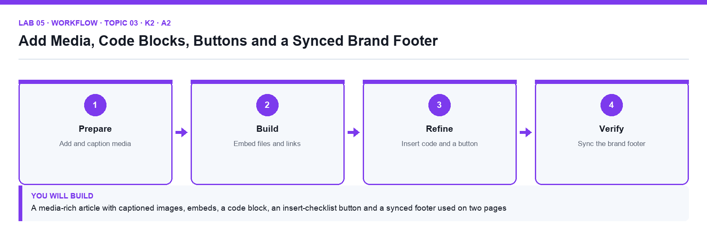
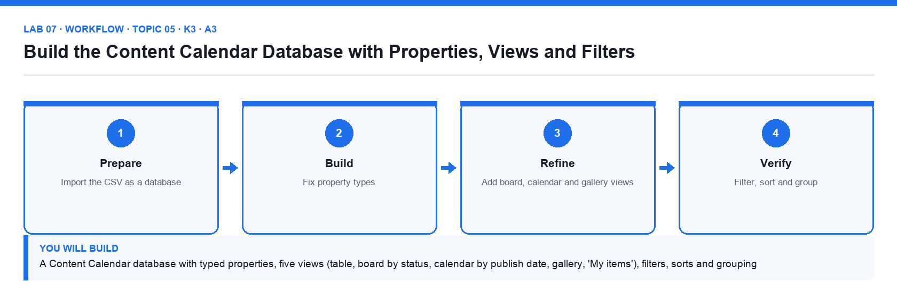
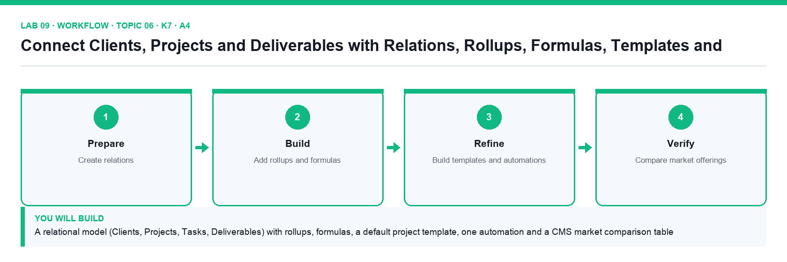

# Mastering Notion for Content, Project, and Database Management — Learner Guide

**Course code:** TGS-2023041080  ·  **Version:** v6  ·  5 September 2026  
**Conducted by:** Tertiary Infotech Academy Pte Ltd (UEN: 201200696W)


## How to Use This Guide

This Learner Guide accompanies the WSQ course Mastering Notion for Content, Project, and Database Management (TGS-2023041080), conducted by Tertiary Infotech Academy Pte Ltd. It contains the full click-by-click procedure for all 12 hands-on labs, organised by the nine course topics. The slide deck used in class is deliberately visual and concept-led — every detailed procedure lives here and in the instruction PDF inside each lab folder.

Brightwave Media Pte Ltd is a twelve-person Singapore content and digital-marketing agency. It is moving its company wiki, content operations, client projects and public help centre into one Notion workspace. Every lab builds one piece of that workspace, so by the end of Day 2 you have a complete, governed content management system.


### What you need

- A laptop with a modern browser (Chrome, Edge, Safari or Firefox) or the Notion desktop app, and a stable internet connection.
- A free Notion account (notion.com → Sign up). A personal email is fine; you will create the Brightwave Media workspace in Lab 1.
- The lab folders from the LMS (Activities) or the GitHub repository — one folder per lab with its mock data.
- For Lab 12, access to Notion AI: Free and Plus workspaces receive complimentary trial responses; the trainer can add you to the course Business workspace if needed.
- For Lab 11, a terminal with curl or Python 3 to call the Notion API (optional but recommended).


### Course and lab file access

- Course materials (slides, this guide, lesson plan, lab folders) are on the LMS/TMS portal at https://lms-tms.tertiaryinfotech.com.
- The lab folders are also published at https://github.com/tertiarycourses/TGS-2023041080-Mastering-Notion-for-Content-Project-and-Database-Management — clone the repository or download the ZIP.
- You may use this guide, the slides and your own completed lab work during the open-book assessment.


### How each lab section is organised

- Goal and what you will build — the outcome in one paragraph.
- Before you begin — the files and pages that must already be in place.
- Detailed procedure — numbered steps with the exact menu names, keyboard shortcuts and expected results.
- Acceptance check — how you prove the lab is complete.
- Evidence to retain — the screenshots to keep for the practical assessment.


## Course Learning Outcomes

- LO1: Implement content management policies on Notion adhering to organizational guidelines and permissions
- LO2: Post and update content on Notion, ensuring adherence to content creation and curation guidelines
- LO3: Maintain web properties and assets in Notion, while staying aware of market offerings
- LO4: Report on performance metrics, recommend appropriate plug-ins, and generate ideas to enhance customer and visitor experiences on Notion


## Assessed Knowledge and Abilities

The Written Assessment (9 questions, 1 hour) covers every knowledge statement (K); the Practical Performance (5 tasks, 1 hour) covers every ability statement (A). Each lab states the codes it develops.

| Code | Statement | Developed in |
|---|---|---|
| K1 | Content management policies, guidelines and permissions on content management | Lab 01, Lab 02 |
| K2 | Web content for deployment | Lab 04, Lab 05 |
| K3 | Organisation's web properties and assets | Lab 07, Lab 08 |
| K4 | Creation and curation of web content guidelines | Lab 06 |
| K5 | Web content and platform management systems | Lab 03 |
| K6 | Types of performance metrics of content management systems | Lab 10 |
| K7 | Customer and visitor experience on web properties and assets | Lab 09 |
| K8 | Types of market offerings on content management systems | Lab 12 |
| K9 | Types of plug-ins to manage the organisation's web properties and assets | Lab 11 |
| A1 | Implement content management policies, guidelines and permissions on content management | Lab 01, Lab 02, Lab 03 |
| A2 | Post and update content on content management systems | Lab 04, Lab 05, Lab 06 |
| A3 | Maintain web properties and assets to uphold standards on user experience | Lab 07, Lab 08 |
| A4 | Maintain awareness of market offerings on content management systems | Lab 09 |
| A5 | Report on metrics to measure performance of content management systems | Lab 10 |
| A6 | Recommend the adoption of appropriate plug-ins to manage and maintain the organisation's web properties and assets | Lab 11 |
| A7 | Generate ideas to improve customer and visitor experience on web properties and assets | Lab 12 |


## Notion Quick Reference


**Keyboard shortcuts and Markdown**

| Action | Mac | Windows / Linux | Markdown alternative |
|---|---|---|---|
| New page | Cmd + N | Ctrl + N | — |
| Quick Find (search) | Cmd + P or Cmd + K | Ctrl + P or Ctrl + K | — |
| Bold / italic / underline | Cmd + B / I / U | Ctrl + B / I / U | **bold**  *italic* |
| Inline code | Cmd + E | Ctrl + E | `code` |
| Link selected text | Cmd + K | Ctrl + K | — |
| Heading 1 / 2 / 3 | Cmd + Option + 1 / 2 / 3 | Ctrl + Shift + 1 / 2 / 3 | # / ## / ### |
| Bulleted / numbered list | Cmd + Shift + 5 / 6 | Ctrl + Shift + 5 / 6 | - item  /  1. item |
| To-do / toggle | Cmd + Shift + 4 / 7 | Ctrl + Shift + 4 / 7 | [] item  /  > item |
| Comment | Cmd + Shift + M | Ctrl + Shift + M | — |
| Highlight (last colour) | Cmd + Shift + H | Ctrl + Shift + H | — |
| Open Notion AI | Space on an empty line; Cmd + Shift + J | Space on an empty line; Ctrl + Shift + J | /ai |
| Any block | / then the block name | / then the block name | ---  divider, ``` code, " quote |


**Menus you will use constantly**

| Symbol | Where | What it does |
|---|---|---|
| ⋮⋮ | Left of any block on hover | Block menu: Turn into, Duplicate, Delete, Move to, Colour, Copy link; drag to move |
| ⋯ | Top right of a page; next to a sidebar page | Page menu: font, small text, full width, lock, customise page, page history, export, delete, Turn into wiki |
| Share | Top right of a page | Invite people and groups, set permission levels, Publish to web |
| + New / New ▾ | Top right of a database | Add a row; the ▾ manages templates |
| Filter · Sort · ⋯ (view options) | Above a database | Filters, sorts, groups, properties, layout, lock database, automations |
| @  [[  + | While typing | Mention a person/page/date; link or create a page; create a page elsewhere |


**Conventions used in this guide**

- Menu paths are written with arrows, for example Share → Publish → Publish to web.
- Text you type is shown in italics or in a fenced block; property names and page titles are in Title Case as they appear in Notion.
- 'Cmd/Ctrl' means Command on Mac and Control on Windows.
- Each lab assumes the previous labs are complete; if you start mid-course, import the previous labs' mock data first.
- Screenshots for evidence must not show passwords, personal emails of others or API tokens.


## Topic 01 — Introduction to Notion

LU1 · A1 · K1 · Day 1. Overview of Notion · what is a block · first page and subpage · workspace and sidebar · navigating and customising · wikis and verified pages.


**Key concepts**

- One connected workspace — Notion combines documents, wikis, project trackers and databases in one tool, so content, projects and data live together instead of across five apps.
- Everything is a block — Text, headings, images, tables, embeds and even databases are blocks. Blocks can be transformed into other types and rearranged by dragging.
- Pages nest inside pages — A page holds blocks and sub-pages, giving an unlimited hierarchy. Breadcrumbs and the sidebar show where you are.
- The workspace and sidebar — The sidebar is the map: Teamspaces for shared work, Private for your own pages, Shared for pages shared with you, plus Favorites, Templates, Import and Trash.
- Workspaces are separate — Each workspace has its own members, plan and content. Switch or add another account from the workspace switcher; move top-level pages to migrate content.
- Wikis and verified pages — Turn a teamspace page into a wiki to add owners, verification and expiry, so the organisation knows which content is authoritative and current.


### Lab 01 — Set Up the Brightwave Workspace, Pages and Blocks

Alignment: K1 · A1.  Level: Foundation.  Tools: Notion (web or desktop app).

Objective: Create a Notion workspace and build its first page hierarchy from blocks, following the agreed structure.

Goal: You create the Brightwave Media workspace, build the top-level page structure from the supplied site map, and learn how blocks, slash commands, sub-pages, breadcrumbs and the sidebar work by building the Company Home page.


**What you will build**

A Brightwave workspace with a Company Home page, four top-level section pages and a working sub-page hierarchy


*Figure 1. Lab 01 workflow — the four stages and the artifact produced.*


**Before you begin**

- Open the lab folder labs/lab-01-set-up-the-brightwave-workspace-pages-and-blocks and read README.md and lab.yaml.
- Have the Brightwave Media workspace open in Notion from the previous labs.
- Confirm the file brightwave-company-profile.md is present — Company background used for the Company Home callout.
- Confirm the file workspace-structure.csv is present — Site map of the four sections and their sub-pages.


**Detailed procedure**

1. **Sign in and create the workspace**  
   Go to notion.com and sign in (a free personal account is enough for the course). In the workspace switcher at the top left choose Create or join workspace, select For my team, name it Brightwave Media and choose the Free plan. The new workspace opens with a Getting Started page.
2. **Read the supplied site map**  
   Open workspace-structure.csv from the lab folder. It lists the four top-level sections — Company Wiki, Content Hub, Client Projects and Help Centre — and the sub-pages each must contain.
3. **Create the Company Home page**  
   In the sidebar click + New page (or the + next to Private). Title it Company Home, click Add icon and choose a lighthouse emoji, then Add cover and pick a gallery image. Press Enter to start writing in the body.
4. **Add blocks with slash commands**  
   On the first empty line type /heading 1 and enter Welcome to Brightwave. Type /callout and write the one-line purpose of the workspace from brightwave-company-profile.md. Type /divider, then /bulleted list and list the four sections.
5. **Transform and rearrange blocks**  
   Hover a bullet, click the ⋮⋮ handle and choose Turn into → Toggle list. Drag the callout above the heading using the ⋮⋮ handle, then drag it back. Right-click a block to Duplicate and Delete it.
6. **Create the four section pages as sub-pages**  
   Under the bulleted list type /page and title it Company Wiki; press the back breadcrumb to return. Repeat for Content Hub, Client Projects and Help Centre. Each appears nested under Company Home in the sidebar.
7. **Build the second level from the site map**  
   Open Company Wiki and create the sub-pages listed in the CSV (About Brightwave, Policies, Team Directory, Onboarding). Do the same for the other three sections. Use the breadcrumbs at the top to move back up.
8. **Organise the sidebar**  
   Drag Company Home to the top of the Private section, click the ⋯ next to it and choose Add to Favorites so a Favorites section appears. Collapse and expand the toggles to check the hierarchy matches the CSV.
9. **Record the result**  
   Open the Steps checklist in the lab README and tick each step. Take a screenshot of the sidebar showing the full hierarchy for your evidence.


**Acceptance check**

The sidebar shows Company Home in Favorites with the four section pages nested under it, each section contains the sub-pages listed in workspace-structure.csv, and Company Home carries an icon, a cover, a heading, a callout and a toggle list.


**Evidence to retain**

- Screenshot of the expanded sidebar and of the Company Home page.
- The ticked Steps checklist in the lab README (or lab.yaml status).
- Credential-safe screenshots only — never capture passwords, other people's emails or API tokens.


---


### Lab 02 — Build the Company Wiki with Verified Pages and a Content Policy

Alignment: K1 · A1.  Level: Foundation.  Tools: Notion, Markdown import.

Objective: Implement content management policies, page ownership and verification in a Notion wiki.

Goal: You turn the Company Wiki into a Notion wiki, import the supplied policy documents, assign page owners, verify the authoritative pages with an expiry date, and publish the content management policy that governs the rest of the workspace.


**What you will build**

A Notion wiki with imported policy pages, named owners, verified status and a visible content management policy


*Figure 2. Lab 02 workflow — the four stages and the artifact produced.*


**Before you begin**

- Open the lab folder labs/lab-02-build-the-company-wiki-with-verified-pages-and-a-content-policy and read README.md and lab.yaml.
- Have the Brightwave Media workspace open in Notion from the previous labs.
- Confirm the file policies/content-management-policy.md is present — The organisation's content management policy to import.
- Confirm the file policies/naming-conventions.md is present — Page naming and structure conventions to import.
- Confirm the file page-owner-register.csv is present — Which person owns which wiki page.


**Detailed procedure**

1. **Move Company Home into a teamspace**  
   Wikis live in teamspaces. In the sidebar click the ⋯ next to Company Home → Move to → your workspace's default teamspace (created with the workspace). The whole hierarchy moves with it.
2. **Turn Company Wiki into a wiki**  
   Open Company Wiki, click the ⋯ at the top right and choose Turn into wiki. Notion adds a wiki header with Owner, Verification and Last edited columns and a home view of all pages.
3. **Import the policy documents**  
   Open the Policies sub-page. Click Import in the sidebar (or the ⋯ → Import), choose Text & Markdown and upload content-management-policy.md and naming-conventions.md from the policies folder. Move the imported pages under Policies if they land elsewhere.
4. **Read the content management policy**  
   Open the imported Content Management Policy page. Note the five rules: one owner per page, verified pages expire after 90 days, naming convention for titles, approved templates only, and permissions by teamspace. Every later lab applies these rules.
5. **Assign page owners**  
   Open page-owner-register.csv. In the wiki's All pages view set the Owner property for each page to the named person (assign yourself where the register says 'Content Manager'). The Owner column shows a person avatar.
6. **Verify the authoritative pages**  
   Open Content Management Policy, click Verify at the top → Verify this page, and set expiry to 90 days. Repeat for Naming Conventions and About Brightwave. A green verified badge appears; unverified pages show none.
7. **Add the verification view**  
   In the wiki home click + Add a view → Table, name it Verification, group by Verification status and add a filter Verification is not Verified so the owner sees what still needs review.
8. **Add the policy notice to Company Home**  
   On Company Home add a callout that reads 'All pages follow the Content Management Policy' and use @ to mention the policy page inside the callout so it links directly.
9. **Check compliance against the naming convention**  
   Rename any page that breaks the naming convention (Title Case, no abbreviations, no dates in titles). Confirm every page in the wiki has an owner.


**Acceptance check**

Company Wiki shows the wiki header, three pages carry the green Verified badge with a 90-day expiry, every page has an owner matching page-owner-register.csv, the Verification view lists only unverified pages, and Company Home links to the policy.


**Evidence to retain**

- Screenshot of the wiki home with the Owner and Verification columns, and of a verified page header.
- The ticked Steps checklist in the lab README (or lab.yaml status).
- Credential-safe screenshots only — never capture passwords, other people's emails or API tokens.


---


## Topic 02 — Workspace Collaboration Tools

LU1 · A1 · K5 · Day 1. Collaborate within a workspace · comments, mentions and reminders · updates and notifications · search.


**Key concepts**

- Real-time co-editing — Several people edit the same page at once; avatars show who is where, and page history lets you restore an earlier version.
- Comments and discussions — Top-level page discussions and inline comments keep feedback next to the content; resolve, react to or reopen threads.
- @-mentions — Type @ to mention a person, a page or a date. A mentioned person is notified; a mentioned page becomes a link and a backlink.
- Reminders — Any date mention can carry a reminder, so a review date notifies the owner on the day, in the app and by email or push.
- Updates and notifications — The Inbox (Updates) collects mentions, comments and page changes across the workspace; tune email and mobile notifications in Settings.
- Search that understands structure — Quick Find searches titles and content; filter by teamspace, creator, date or page, sort results and search inside a database.


### Lab 03 — Run a Content Review with Comments, Mentions, Reminders and Search

Alignment: K5 · A1.  Level: Intermediate.  Tools: Notion comments, mentions, reminders, Inbox, Search.

Objective: Use Notion's collaboration tools to review content, assign follow-ups and find information across the workspace.

Goal: Acting as the reviewer of the About Brightwave page, you raise the feedback items from the supplied review sheet as comments, mention the owners, set dated reminders, resolve threads, watch the Inbox, and use Search filters to find every page that mentions a client.


**What you will build**

A reviewed page with a comment thread per feedback item, mentions and reminders assigned, resolved threads, and a saved search routine


*Figure 3. Lab 03 workflow — the four stages and the artifact produced.*


**Before you begin**

- Open the lab folder labs/lab-03-run-a-content-review-with-comments-mentions-reminders-and-search and read README.md and lab.yaml.
- Have the Brightwave Media workspace open in Notion from the previous labs.
- Confirm the file review-feedback.csv is present — Six review comments to raise, with target text, action and owner.
- Confirm the file reminders.csv is present — The two follow-up dates and their owners.


**Detailed procedure**

1. **Open the page to review**  
   Open Company Wiki → About Brightwave. Open review-feedback.csv: each row is a feedback item with the text to comment on, the action needed and the owner.
2. **Add a top-level page discussion**  
   Click Add comment under the page title (the page discussion area). Write 'Review round 1 — see inline comments' and post it with Cmd/Ctrl+Enter.
3. **Raise inline comments**  
   For each CSV row, highlight the sentence named in the Target text column, click Comment in the floating toolbar and paste the Action text. Six inline comments should appear in the right-hand comments sidebar.
4. **Mention the owner in each comment**  
   Edit each comment and type @ followed by the owner's name (use your own name for items owned by the Content Manager). The mentioned person receives a notification in Inbox and by email.
5. **Add dated reminders**  
   In the two comments marked Follow-up in the CSV, type @ then a date such as @tomorrow, click the date and set Remind → On the day at 9:00 AM. The date chip now shows a bell icon.
6. **Resolve and reopen a thread**  
   Fix the typo named in row 1 directly in the page text, then click ✓ Resolve on that comment. Open the comments sidebar → Resolved to see it, and click Reopen to see it return.
7. **Read the Inbox**  
   Click Inbox in the sidebar. Check that your mentions appear under the Inbox tab and that the page change appears under All. Archive one notification.
8. **Use Search with filters**  
   Press Cmd/Ctrl+K or click Search. Type Nova Retail (a client named in the profile). Use the filters to limit to Only match titles off, Created by you, and In: Company Wiki; sort by Last edited. Note how many pages match.
9. **Search inside a page and check page history**  
   Open About Brightwave, press Cmd/Ctrl+F to find 'founded', then open ⋯ → Page history to see the snapshot from before your edits.


**Acceptance check**

About Brightwave shows one resolved and five open inline comments, each with an @-mentioned owner, two comments carry reminder bells, the Inbox lists the mentions, and the Nova Retail search returns the pages that name that client.


**Evidence to retain**

- Screenshot of the comments sidebar with mentions and reminder chips, and of the filtered search results.
- The ticked Steps checklist in the lab README (or lab.yaml status).
- Credential-safe screenshots only — never capture passwords, other people's emails or API tokens.


---


## Topic 03 — Pages and Content Blocks

LU2 · A2 · K2 · Day 1. Writing, editing and customisation · keyboard shortcuts · columns, tables, headings and dividers · images, files and media · code blocks and buttons · synced blocks.


**Key concepts**

- Slash commands create blocks — Type / for every block type: basic (text, headings, lists, toggles, quotes, callouts), database, media, embeds and advanced blocks.
- Markdown and shortcuts — Markdown-style shortcuts (#, -, [], >, ```) and keyboard shortcuts (Cmd/Ctrl+B, Cmd/Ctrl+E, Cmd/Ctrl+Shift+0-9) make writing fast.
- Structure with layout blocks — Headings build the table of contents, dividers separate sections, simple tables hold small grids and drag-to-side creates columns.
- Media in context — Upload or embed images, files, video, audio, PDFs and web bookmarks; align, resize and caption them where the content needs them.
- Code blocks and buttons — Code blocks add syntax highlighting, wrap and copy; buttons insert blocks, add pages or edit properties in one click.
- Synced blocks — Content that must appear in several places (a footer, a policy notice) is written once in a synced block and edited everywhere at once.


### Lab 04 — Draft and Format a Blog Article with Blocks, Columns and Tables

Alignment: K2 · A2.  Level: Foundation.  Tools: Notion editor, Markdown shortcuts.

Objective: Post and format web content in Notion using blocks, keyboard shortcuts, columns, tables, headings and dividers.

Goal: You post the supplied blog article draft into the Content Hub, structure it with headings, lists, toggles, quotes and dividers using slash commands and Markdown shortcuts, lay out a two-column comparison, and add a simple table from the facts sheet so the article is ready for deployment.


**What you will build**

A fully structured blog article page in the Content Hub with headings, a table of contents, two columns and a facts table


*Figure 4. Lab 04 workflow — the four stages and the artifact produced.*


**Before you begin**

- Open the lab folder labs/lab-04-draft-and-format-a-blog-article-with-blocks-columns-and-tables and read README.md and lab.yaml.
- Have the Brightwave Media workspace open in Notion from the previous labs.
- Confirm the file blog-article-draft.md is present — The article text to post, in Markdown.
- Confirm the file article-facts-table.csv is present — The figures for the 'By the numbers' table.


**Detailed procedure**

1. **Create the article page**  
   Open Content Hub → Blog Articles (create the sub-page if it is missing) and add a new page titled Five Content Trends for 2027. Add an icon and cover so it is recognisable in the sidebar.
2. **Paste the draft as blocks**  
   Open blog-article-draft.md, copy everything and paste into the page. Notion converts each Markdown heading, bullet and paragraph into its own block. Check the headings arrived as Heading 1/2 blocks (hover shows the type).
3. **Add a table of contents**  
   Directly under the title type /table of contents. The block lists every heading and updates as you edit. Click an entry to jump.
4. **Apply Markdown and keyboard shortcuts**  
   In the introduction: type ** around a phrase for bold, use Cmd/Ctrl+E for inline code on the tool names, Cmd/Ctrl+Shift+H to highlight, and Cmd/Ctrl+Shift+7 to turn the trend list into a numbered list. Undo with Cmd/Ctrl+Z.
5. **Use toggles and quotes**  
   Turn the 'Methodology' paragraph into a toggle (type > at the start of the line) so it is collapsed by default. Turn the expert quotation into a quote block with the ⋮⋮ → Turn into menu.
6. **Create a two-column layout**  
   Drag the 'Short-form video' paragraph to the right edge of the 'Long-form articles' paragraph until a blue vertical guide appears and drop it. Drag the column divider to make the columns equal. Use the ⋮⋮ → Turn into → Text of the column to remove it if needed.
7. **Insert a simple table**  
   Under 'By the numbers' type /table and choose Table (the simple table, not a database). Give it 3 columns and 6 rows, tick Header row, and type the values from article-facts-table.csv. Use the ⋮⋮ on a row to reorder.
8. **Add dividers and headings**  
   Insert /divider between major sections and check the heading hierarchy: one Heading 1, Heading 2 per trend, Heading 3 for sub-points. Fix any level that breaks the hierarchy.
9. **Duplicate, delete and restore**  
   Duplicate the table with ⋮⋮ → Duplicate, delete the copy with Delete, then open Trash in the sidebar to see deleted pages, and ⋯ → Page history to confirm a snapshot exists.


**Acceptance check**

The article page has a working table of contents, one Heading 1 and a Heading 2 per trend, a collapsed toggle, a quote block, an equal two-column section and a six-row simple table with a header row matching article-facts-table.csv.


**Evidence to retain**

- Screenshot of the article showing the table of contents, columns and table.
- The ticked Steps checklist in the lab README (or lab.yaml status).
- Credential-safe screenshots only — never capture passwords, other people's emails or API tokens.


---


### Lab 05 — Add Media, Code Blocks, Buttons and a Synced Brand Footer

Alignment: K2 · A2.  Level: Intermediate.  Tools: Notion media blocks, code blocks, buttons, synced blocks.

Objective: Use images, files, embeds, code blocks, buttons and synced blocks to maintain consistent, media-rich content.

Goal: You enrich the article and the Content Hub with the supplied hero image and chart, an embedded PDF and video bookmark, a syntax-highlighted code sample, a button that inserts a standard 'article checklist', and a synced brand footer that appears on every article and updates from one place.


**What you will build**

A media-rich article with captioned images, embeds, a code block, an insert-checklist button and a synced footer used on two pages



*Figure 5. Lab 05 workflow — the four stages and the artifact produced.*


**Before you begin**

- Open the lab folder labs/lab-05-add-media-code-blocks-buttons-and-a-synced-brand-footer and read README.md and lab.yaml.
- Have the Brightwave Media workspace open in Notion from the previous labs.
- Confirm the file media/brightwave-hero.png is present — Hero image for the article.
- Confirm the file media/brightwave-chart.png is present — Chart image for the 'By the numbers' section.
- Confirm the file media/brightwave-media-kit.pdf is present — PDF to embed as a file block.
- Confirm the file embed-links.md is present — Video, bookmark and map links to embed.
- Confirm the file code-sample.py is present — UTM tagging helper for the code block.
- Confirm the file brand-footer.md is present — Brand footer text and the article checklist.


**Detailed procedure**

1. **Upload the hero image**  
   Open Five Content Trends for 2027. Under the title type /image → Upload and choose media/brightwave-hero.png. Drag its side handles to full width, then hover and click Caption to add 'Brightwave content trends 2027'.
2. **Add the chart image with alignment**  
   Under 'By the numbers' add /image with media/brightwave-chart.png. Use the alignment icons on hover to centre it and resize it to about two-thirds width. Click Replace to see how an image is swapped without losing the caption.
3. **Embed a file and a web bookmark**  
   Type /file and upload media/brightwave-media-kit.pdf; then type /web bookmark and paste https://www.notion.com/help/intro-to-databases. Notice the bookmark unfurls with a title and preview. Try /video with a YouTube URL from embed-links.md.
4. **Add a code block with syntax highlighting**  
   Under the 'Tracking script' heading type /code, paste the contents of code-sample.py, set the language to Python, toggle Wrap code on, and click the copy icon to confirm it copies. Add a caption 'UTM tagging helper'.
5. **Create a button that inserts the article checklist**  
   At the top of Blog Articles type /button, name it Insert article checklist, add the action Insert blocks, and build a to-do list from brand-footer.md's checklist section (SEO title, meta description, hero image, footer). Click Done, then click the button to test it.
6. **Write the brand footer as a synced block**  
   At the bottom of the article type /synced block. Inside it add a divider, a callout with the Brightwave contact line from brand-footer.md and a link to the Help Centre page. The red outline marks a synced block.
7. **Reuse the synced block on a second page**  
   Click Copy and sync at the top right of the synced block, open another article page (create Content Trends Webinar Recap) and paste. Edit the contact line in one copy and watch the other update.
8. **Unsync a copy and observe**  
   On the second page choose the synced block ⋯ → Unsync. Edit it and confirm the original no longer changes. Then delete the unsynced copy and paste the synced version again.
9. **Check media on mobile width**  
   Drag the browser narrow (or open Notion on your phone) to confirm the images scale, the columns stack and the code block wraps.


**Acceptance check**

The article shows a captioned full-width hero image, a centred chart, an embedded PDF, a web bookmark, a Python code block with wrap on, the Insert article checklist button inserts four to-dos, and the same synced footer appears on two pages and updates in both when edited.


**Evidence to retain**

- Screenshot of the article with media and code block, and of the synced block on the second page.
- The ticked Steps checklist in the lab README (or lab.yaml status).
- Credential-safe screenshots only — never capture passwords, other people's emails or API tokens.


---


## Topic 04 — Advanced Content Techniques

LU2 · A2 · K4 · Day 1. Customising and styling content · links, backlinks and efficient navigation · math equations and diverse media types.


**Key concepts**

- Style with intent — Text colours, background colours, fonts (default, serif, mono), small text and full width are used per the style guide, not per mood.
- Callouts, icons and covers — Callouts highlight warnings and tips; page icons and cover images make pages recognisable in the sidebar and in search.
- Links and backlinks — Link inline with @ or [[; every link creates a backlink on the target page, so readers can navigate in both directions.
- Navigation hubs — A home page with link-to-page blocks, a table of contents block and breadcrumbs gives readers one entry point to the whole space.
- Math equations — KaTeX equations render as a block (/math) or inline ($$), for pricing formulas, KPIs and technical documentation.
- Curation guidelines — A style guide, naming convention and review workflow turn individual pages into a consistent, trustworthy body of content.


### Lab 06 — Apply the Style Guide: Callouts, Links, Backlinks, Equations and a Navigation Hub

Alignment: K4 · A2.  Level: Intermediate.  Tools: Notion styling, links and backlinks, math equations, link-to-page blocks.

Objective: Curate content to the organisation's guidelines with consistent styling, linked navigation and technical notation.

Goal: You apply the supplied Brightwave style guide across the Content Hub — colours, fonts, callout conventions, icons and covers — build a navigation hub with link-to-page blocks and backlinks so every article is reachable in two clicks, and document the pricing formula with KaTeX equations.


**What you will build**

A styled Content Hub with a navigation hub page, backlinks on every article, a style-compliant callout system and an equations page


*Figure 6. Lab 06 workflow — the four stages and the artifact produced.*


**Before you begin**

- Open the lab folder labs/lab-06-apply-the-style-guide-callouts-links-backlinks-equations-and-a-navigation-hub and read README.md and lab.yaml.
- Have the Brightwave Media workspace open in Notion from the previous labs.
- Confirm the file style-guide.md is present — Brightwave content style guide.
- Confirm the file navigation-map.csv is present — Which pages the hub must link to, in order.
- Confirm the file equations.md is present — The retainer and ROI formulas in KaTeX.


**Detailed procedure**

1. **Read the style guide**  
   Open style-guide.md. Note the rules: blue callouts for tips, yellow for warnings, red for policy; serif font is not allowed; page icons must be emoji; covers only on section pages; small text off.
2. **Fix page-level styling**  
   Open Five Content Trends for 2027 → ⋯ menu. Set Font to Default, turn Small text off and Full width on. Check the icon is an emoji and remove the cover (the article is not a section page).
3. **Apply text and background colours**  
   Select the key statistic in the introduction and use the toolbar A menu to set a blue text colour. Select the warning sentence and set a yellow background. Use Cmd/Ctrl+Shift+H to repeat the last colour.
4. **Standardise callouts**  
   Convert the tip paragraph into a callout with a 💡 icon and blue background, the caution paragraph into a callout with ⚠️ and yellow background, and add a red policy callout that @-mentions the Content Management Policy.
5. **Build the navigation hub**  
   Open Content Hub. Type /link to page for each article and for Blog Articles, Newsletters and Social Posts (create empty pages where needed). Add a heading 'Start here', a table of contents block and a divider between groups.
6. **Create inline links two ways**  
   In the article introduction type @ and choose the Content Hub page to create an inline mention; then type [[ and choose Company Home. Highlight the word 'policy', press Cmd/Ctrl+K and paste the policy page URL to link plain text.
7. **Check backlinks**  
   Open Company Home. Under the title, click the Backlinks indicator to see every page that links here, including the article. In ⋯ → Customize page set Backlinks to Show in popover and Comments to Expanded.
8. **Add math equations**  
   Create a page Pricing Formulas under Company Wiki → Policies. Type /math equation and enter the block equation from equations.md (the retainer formula). In a sentence type $$ROI = \frac{Gain - Cost}{Cost}$$ to render it inline, then click it to edit.
9. **Add icons and covers to section pages**  
   Give the four section pages a distinct emoji icon and a cover each (Unsplash search in the cover picker). Confirm no article page has a cover, per the style guide.


**Acceptance check**

Every article follows the style guide (default font, emoji icon, no cover, colour-coded callouts), Content Hub is a navigation hub with link-to-page blocks and a table of contents, Company Home's backlinks list the article, and Pricing Formulas renders a block and an inline KaTeX equation.


**Evidence to retain**

- Screenshot of the navigation hub, of the backlinks popover and of the equations page.
- The ticked Steps checklist in the lab README (or lab.yaml status).
- Credential-safe screenshots only — never capture passwords, other people's emails or API tokens.


---


## Topic 05 — Database Essentials

LU3 · A3 · K3 · Day 2. Introduction to databases in Notion · properties and data sources · tasks, dependencies and linked databases · database views.


**Key concepts**

- A database is a set of pages — Every row, card or event is a full Notion page with properties on top and free content below. Full-page or inline, the data is the same.
- Properties give structure — Title, text, number, select, multi-select, status, date, person, files, checkbox, URL, email, phone, formula, relation, rollup, created/edited time and ID.
- Databases vs spreadsheets — There are no cell coordinates; each row has the same properties with its own values. That is why the same data can be shown as a board or calendar.
- Views change the lens — Table, board, list, calendar, timeline, gallery, chart and form are layouts of one data source; each view keeps its own filters, sorts and groups.
- Filters, sorts and groups — Simple filters target one property; advanced filters combine AND/OR groups. A filtered view also sets defaults on new rows (a forcing function).
- Data sources and linked views — A linked view shows an existing data source in another page with its own views; sub-items and dependencies model task hierarchies and date shifting.


### Lab 07 — Build the Content Calendar Database with Properties, Views and Filters

Alignment: K3 · A3.  Level: Foundation.  Tools: Notion databases (table, board, calendar, gallery views).

Objective: Maintain the organisation's web content assets in a database with typed properties, multiple views, filters, sorts and groups.

Goal: You import the supplied content calendar CSV into a full-page database in the Content Hub, correct the property types, open rows as pages, add board, calendar and gallery views, and build filtered views for each editor so the team maintains every web asset from one source.


**What you will build**

A Content Calendar database with typed properties, five views (table, board by status, calendar by publish date, gallery, 'My items'), filters, sorts and grouping



*Figure 7. Lab 07 workflow — the four stages and the artifact produced.*


**Before you begin**

- Open the lab folder labs/lab-07-build-the-content-calendar-database-with-properties-views-and-filters and read README.md and lab.yaml.
- Have the Brightwave Media workspace open in Notion from the previous labs.
- Confirm the file content-calendar.csv is present — Thirty-six content items with status, channel, tags, dates and owners.


**Detailed procedure**

1. **Import the CSV**  
   Open Content Hub. In the sidebar click Import → CSV and choose content-calendar.csv. Notion creates a full-page database named after the file with one row per line. Rename it Content Calendar and move it under Content Hub.
2. **Inspect the imported properties**  
   Every column arrived as a property, but several as Text. Click a column header → Edit property → Type and set: Status → Status, Channel → Select, Tags → Multi-select, Publish Date → Date, Owner → Person (assign yourself), Word Count → Number, URL → URL, Approved → Checkbox.
3. **Open a row as a page**  
   Hover the first row's Name and click Open. The properties appear at the top and the page body below. Add a short brief in the body. Click ⋯ → Customize page to hide empty properties, then close the peek.
4. **Add and reorder properties**  
   Add a Created time property and an ID property (prefix BW). Drag the columns so Name, Status, Channel, Owner and Publish Date come first; hide Word Count in this view with the eye icon in the property list.
5. **Add a board view by status**  
   Click + next to the view tabs → Board. Group by Status; drag a card from Draft to In Review and see its Status update. Turn on Sub-group by Channel.
6. **Add a calendar view**  
   Add a Calendar view, choose Show calendar by Publish Date, and drag an item to a new date. Switch to Week view and back to Month.
7. **Add a gallery view**  
   Add a Gallery view, set Card preview to Page cover and Card size to Medium, and show the Channel and Status properties on the cards.
8. **Filter, sort and group the table**  
   In the Table view add a filter Status is not Published, a sort by Publish Date ascending, and Group by Channel. Then add an advanced filter: Channel is Blog OR (Tags contains Campaign AND Approved is unchecked). Click Save for everyone.
9. **Create a personal 'My items' view**  
   Duplicate the Table view, rename it My items and filter Owner contains Me. Add a new row inside this view and notice the Owner is pre-filled — a filtered view is a forcing function.
10. **Lock the database views**  
   Click ⋯ at the top right → Lock database so teammates can edit content but not the properties or views. Note the lock icon.


**Acceptance check**

Content Calendar contains every row from content-calendar.csv with the corrected property types, has table, board (grouped by Status, sub-grouped by Channel), calendar, gallery and My items views, the advanced filter returns only the matching rows, and the database is locked.


**Evidence to retain**

- Screenshots of the table view with filters and of the board view.
- The ticked Steps checklist in the lab README (or lab.yaml status).
- Credential-safe screenshots only — never capture passwords, other people's emails or API tokens.


---


### Lab 08 — Manage Client Projects with Sub-tasks, Dependencies, Timeline and Linked Views

Alignment: K3 · A3.  Level: Intermediate.  Tools: Notion databases (timeline, sub-items, dependencies, linked views).

Objective: Maintain project and task assets with sub-items, dependencies, a timeline and linked database views embedded in other pages.

Goal: You create the Projects and Tasks databases in Client Projects from the supplied CSVs, turn on sub-items and dependencies so date changes shift dependent tasks, plan the Nova Retail launch on a timeline, and embed linked views of the tasks inside each project page and on the Company Home dashboard.


**What you will build**

Projects and Tasks databases with sub-tasks, dependencies and a timeline, plus linked task views inside project pages and on Company Home


*Figure 8. Lab 08 workflow — the four stages and the artifact produced.*


**Before you begin**

- Open the lab folder labs/lab-08-manage-client-projects-with-sub-tasks-dependencies-timeline-and-linked-views and read README.md and lab.yaml.
- Have the Brightwave Media workspace open in Notion from the previous labs.
- Confirm the file projects.csv is present — Six client projects with client, dates, stage and budget.
- Confirm the file tasks.csv is present — Twenty-four tasks with parents, dependencies, assignees and estimates.


**Detailed procedure**

1. **Create the Tasks database**  
   Open Client Projects. Import tasks.csv as a database named Tasks. Set Status → Status, Due → Date (with end date), Assignee → Person, Estimate (h) → Number, Priority → Select.
2. **Create the Projects database**  
   Import projects.csv as Projects. Set Client → Select, Dates → Date range, Stage → Status, Budget (SGD) → Number with SGD format.
3. **Turn on sub-items**  
   In Tasks click ⋯ → Sub-items → Turn on. Notion adds Parent item and Sub-items properties. Using tasks.csv's Parent column, open each parent task and add its sub-tasks; the table shows a toggle arrow on parents.
4. **Turn on dependencies**  
   Click ⋯ → Dependencies → Turn on, choose Shift only when dates overlap, and set the Blocked by / Blocking properties. Using the Depends on column in the CSV, add each dependency.
5. **Add a timeline view**  
   Add a Timeline view of Tasks, choose Timeline by Due, Month zoom, and Show table with Name, Assignee and Status. Dependency arrows appear between bars.
6. **Shift a date and watch dependencies move**  
   Drag the 'Approve creative concept' bar two days later. The dependent 'Produce launch assets' task shifts too. Undo with Cmd/Ctrl+Z and note the behaviour in your README checklist.
7. **Group and filter the timeline**  
   Group the timeline by Assignee, then filter Status is not Done. Add a table view named Overdue with filter Due is before Today AND Status is not Done.
8. **Embed a linked view inside a project page**  
   Open the Nova Retail Launch project page. Type /linked view of database, choose Tasks, and Create new empty view. Filter it to Project contains Nova Retail Launch (create a Project relation property in Tasks first if it does not exist — Lab 9 completes this). Hide the database title.
9. **Add a dashboard linked view to Company Home**  
   On Company Home add /linked view of database → Tasks → copy the Overdue view. Now the home page shows overdue work across all clients. Add a linked calendar of Content Calendar beside it in a second column.
10. **Lock views on the linked database**  
   On the Company Home linked views use ⋯ → Lock views so the dashboard layout stays fixed while data still changes.


**Acceptance check**

Tasks has parent tasks with sub-items and dependency arrows on the timeline, moving a blocking task shifts its dependents, the Overdue view lists only late open tasks, the Nova Retail Launch page shows only its own tasks in a linked view, and Company Home shows locked linked views of Tasks and Content Calendar.


**Evidence to retain**

- Screenshot of the timeline with dependencies and of the Company Home dashboard.
- The ticked Steps checklist in the lab README (or lab.yaml status).
- Credential-safe screenshots only — never capture passwords, other people's emails or API tokens.


---


## Topic 06 — Advanced Database Features

LU3 · A4 · K7 · Day 2. Relations, rollups and database templates · formula basics and syntax · database automations.


**Key concepts**

- Relations connect databases — A relation property links rows in the same or another database, optionally two-way, so a project knows its tasks and a task knows its project.
- Rollups summarise relations — A rollup reads a property through a relation and aggregates it: count tasks, sum hours, show the earliest due date, percent complete.
- Formulas compute — Formulas use properties, built-ins and functions (if, dateBetween, format, prop) to produce text, numbers, dates, booleans or lists.
- Database templates — A template pre-fills page content and property defaults; set one as default per view so every new brief or ticket starts complete.
- Automations act on triggers — When a property changes or a page is added, an automation can edit properties, add pages, send Slack messages or notify people.
- Market awareness — Notion competes with Confluence, SharePoint, Coda, Airtable and Monday; know the plan tiers and where each tool fits to advise the organisation.


### Lab 09 — Connect Clients, Projects and Deliverables with Relations, Rollups, Formulas, Templates and Automations

Alignment: K7 · A4.  Level: Advanced.  Tools: Notion relations, rollups, formulas, database templates, automations.

Objective: Build a relational content system and stay aware of how Notion compares with other content management offerings.

Goal: You create the Clients and Deliverables databases, relate Clients → Projects → Tasks and Deliverables, roll up hours, budgets and completion, write formulas for health status and days remaining, build a Project Brief template, add an automation that notifies the owner when a deliverable is approved, and complete a market comparison of Notion against Confluence, Airtable and Monday.


**What you will build**

A relational model (Clients, Projects, Tasks, Deliverables) with rollups, formulas, a default project template, one automation and a CMS market comparison table



*Figure 9. Lab 09 workflow — the four stages and the artifact produced.*


**Before you begin**

- Open the lab folder labs/lab-09-connect-clients-projects-and-deliverables-with-relations-rollups-formulas-templates-and-automations and read README.md and lab.yaml.
- Have the Brightwave Media workspace open in Notion from the previous labs.
- Confirm the file clients.csv is present — Five clients with industry, account manager and retainer.
- Confirm the file deliverables.csv is present — Eighteen deliverables linked to projects.
- Confirm the file formulas.md is present — The formulas used in this lab with an explanation of each function.
- Confirm the file automation-rules.csv is present — The automation and button rules to configure.
- Confirm the file cms-market-comparison.csv is present — Comparison grid of Notion, Confluence, Airtable and Monday.com to complete.


**Detailed procedure**

1. **Create the Clients database**  
   In Client Projects import clients.csv as Clients (Industry → Select, Account Manager → Person, Retainer (SGD) → Number).
2. **Relate Projects to Clients**  
   In Projects add a property Client (Relation) → Clients, turn on Show on Clients and name the reverse property Projects. Replace the old Client select values by picking the related client for each row, then delete the select property.
3. **Relate Tasks to Projects**  
   In Tasks add a Relation property Project → Projects with a two-way property Tasks. Assign every task to its project using the Project column in tasks.csv. Return to Lab 8's linked view in Nova Retail Launch and confirm the filter now works.
4. **Create Deliverables and relate them**  
   Import deliverables.csv as Deliverables; add a Relation to Projects (two-way, named Deliverables) and a Status property with Draft, In Review, Approved, Published.
5. **Add rollups**  
   In Projects add rollups: Total Hours = Tasks → Estimate (h) → Sum; Tasks Done = Tasks → Status → Percent per group Complete; Next Due = Tasks → Due → Earliest date. In Clients add Active Projects = Projects → Name → Count and Total Budget = Projects → Budget → Sum.
6. **Write formulas**  
   In Projects add formula Days Left: dateBetween(prop("Dates").end, now(), "days"). Add formula Health: if(prop("Tasks Done") >= 0.8, "🟢 On track", if(prop("Days Left") < 7, "🔴 At risk", "🟡 Watch")). Add formula Budget/Hour: format(round(prop("Budget (SGD)") / prop("Total Hours"))).
7. **Create a Project Brief template**  
   In Projects click the arrow next to New → New template. Title it Project Brief, set default Stage = Planning, and add body sections Objectives, Audience, Channels, Deliverables (a linked view of Deliverables filtered to this project), Risks. Set it as Default for all views.
8. **Add an automation**  
   In Deliverables click ⚡ Automations → New automation. Trigger: Status is set to Approved. Actions: Edit property Approved On = now; Send notification to the Owner person property with 'Deliverable approved — schedule publishing'. Turn it on and test by approving one deliverable.
9. **Add a button automation**  
   In a project page add a /button named Log weekly review whose action Adds a page to Tasks with Name = Weekly review, Project = this project, Due = today + 7 days.
10. **Complete the market comparison**  
   Open cms-market-comparison.csv. Create a simple table on a page Market Offerings under Company Wiki and complete the empty cells for Notion, Confluence, Airtable and Monday.com across pricing tier, databases, wiki, API and publishing, using the Notion Help Center and vendor pages. Write two sentences on where Notion fits Brightwave.


**Acceptance check**

Clients show Active Projects and Total Budget rollups, each project shows Total Hours, Tasks Done, Next Due, Days Left and a Health formula, new projects open with the Project Brief template, approving a deliverable sets Approved On and notifies the owner, and the Market Offerings table is complete for four tools.


**Evidence to retain**

- Screenshots of the Projects table with rollups and formulas, of the automation, and of the market comparison table.
- The ticked Steps checklist in the lab README (or lab.yaml status).
- Credential-safe screenshots only — never capture passwords, other people's emails or API tokens.


---


## Topic 07 — Collaboration and Publishing

LU4 · A5 · K6 · Day 2. Sharing, permissions and member management · collaborative activities · public pages and web publishing · page analytics.


**Key concepts**

- Permission levels — Full access, can edit, can edit content (databases only), can comment and can view; set per person, group, teamspace or the whole workspace.
- Members, guests and groups — Members join the workspace; guests are invited to specific pages; groups make permissions repeatable. Owners manage security settings.
- Teamspaces — Open, closed or private spaces with their own owners, members and default permissions — the unit of organisation for departments and clients.
- Page lock and view lock — Lock a page to prevent accidental edits and lock database views so structure stays fixed while data can still change.
- Publish to the web — Any page can become a public site with a notion.site URL, search-engine indexing, duplication and comment settings, and a public home page.
- Page analytics — Every page shows views, unique visitors and viewers over time; workspace analytics adds member engagement, content and search behaviour.


### Lab 10 — Share, Set Permissions, Publish the Help Centre and Read Page Analytics

Alignment: K6 · A5.  Level: Intermediate.  Tools: Notion sharing, teamspaces, Publish to web, page analytics, chart view.

Objective: Report on content performance metrics after governing access with permissions, teamspaces and web publishing.

Goal: You apply the supplied access matrix with members, guests, groups and teamspaces, lock the policy pages, publish the Help Centre to the web with search indexing and a public home page, then read page analytics and build a metrics dashboard from the supplied analytics sample so you can report on views, visitors and engagement.


**What you will build**

A permission model matching the access matrix, a published Help Centre site, a page-analytics reading and a content metrics dashboard with a chart


*Figure 10. Lab 10 workflow — the four stages and the artifact produced.*


**Before you begin**

- Open the lab folder labs/lab-10-share-set-permissions-publish-the-help-centre-and-read-page-analytics and read README.md and lab.yaml.
- Have the Brightwave Media workspace open in Notion from the previous labs.
- Confirm the file access-matrix.csv is present — Roles versus sections with the required permission level.
- Confirm the file page-analytics-sample.csv is present — Twelve weeks of views, visitors and time-on-page by page.
- Confirm the file publish-checklist.md is present — Pre-publication checklist for public pages.


**Detailed procedure**

1. **Read the access matrix**  
   Open access-matrix.csv. It lists each role (Editor, Designer, Account Manager, Client guest) against each section and the permission level required (Full access, Can edit, Can edit content, Can comment, Can view).
2. **Invite a member and a guest**  
   Open Settings → People. Add a member with a second email you control (or a classmate). Then open Client Projects → Nova Retail Launch, click Share, enter a client email and set Can comment — the person appears as a Guest in Settings → People → Guests.
3. **Create a group**  
   In Settings → People → Groups create Editors and add the member. Share Content Hub with the Editors group at Can edit. Groups keep permissions repeatable as people join or leave.
4. **Create a closed teamspace for clients**  
   In the sidebar click + next to Teamspaces, name it Client Work, set it to Closed, and move Client Projects into it. Set the default access to Can edit content on the databases so guests can add rows but not change structure.
5. **Apply 'can edit content' and page lock**  
   Open Content Calendar → Share and set the Editors group to Can edit content. Open Content Management Policy, click ⋯ → Lock page; try to type and observe the lock. Open Tasks → ⋯ → Lock database.
6. **Review security settings**  
   In Settings → Security review Disable guests, Disable public page sharing, Disable export and Allowed email domains. Leave public sharing on (needed next) and note which settings Brightwave's policy would turn on.
7. **Publish the Help Centre**  
   Open Help Centre → Share → Publish → Publish to web. Turn on Search engine indexing, turn off Allow duplicate as template, keep Allow comments off, and copy the notion.site link. Open it in a private window.
8. **Set a public home page and check the visitor view**  
   In Settings → Sites (or Public pages) set Help Centre as the home page for the site. In the private window check navigation, breadcrumbs and that private pages are not reachable.
9. **Read page analytics**  
   Open Help Centre → ⋯ → Analytics (or the clock icon). Note Views, Unique visitors and the viewer list for the last 7 and 30 days. Open Settings → Analytics for workspace-level content, member and search analytics on paid plans.
10. **Build the metrics dashboard**  
   Import page-analytics-sample.csv as a database Content Metrics under Company Wiki. Add a Chart view: vertical bar, X axis = Week, Y axis = Sum of Views, grouped by Section. Add a second chart view: donut of Sum of Unique Visitors by Channel. Add a formula Engagement = round(prop("Avg Time (s)") / 60) and a callout that states the top three pages this month.


**Acceptance check**

Sharing matches access-matrix.csv (member, guest, Editors group, closed Client Work teamspace), the policy page is locked, the Help Centre opens at a public notion.site URL with indexing on and duplication off, page analytics show views and unique visitors, and Content Metrics has two chart views and an Engagement formula.


**Evidence to retain**

- Screenshots of the Share dialog, the public site in a private window, the page analytics panel and the metrics chart.
- The ticked Steps checklist in the lab README (or lab.yaml status).
- Credential-safe screenshots only — never capture passwords, other people's emails or API tokens.


---


## Topic 08 — Data Management and Integrations

LU4 · A6 · K9 · Day 2. Importing data into Notion · embedding and connecting apps · the Notion API · exporting content and data integrity.


**Key concepts**

- Import from anywhere — Import Confluence, Evernote, Trello, Asana, Google Docs, Word, Excel, CSV, Markdown and HTML; CSV becomes a database with typed properties.
- Embeds — Paste a link to embed Google Drive, Maps, Figma, Loom, YouTube, PDFs, Typeform, GitHub gists and 1,900+ other sources inside a page.
- Connections and link previews — Connect Slack, GitHub, Jira, Google Drive, Zoom and more; pasted links unfurl into live previews and synced databases mirror external issues.
- The Notion API — An integration with a token calls api.notion.com to create pages, query data sources, update properties and search — the basis for Zapier, Make and custom plug-ins.
- Data model in the API — A database object holds one or more data sources; each data source has a schema of properties and rows that are pages (API version 2025-09-03).
- Export and integrity — Export a page or the whole workspace as PDF, HTML or Markdown + CSV; keep backups, page history and the trash policy in the content plan.


### Lab 11 — Import, Embed, Connect Apps, Call the Notion API and Export

Alignment: K9 · A6.  Level: Advanced.  Tools: Notion Import, embeds, Connections, Notion API (integration token), Export.

Objective: Recommend and apply plug-ins and integrations that manage the organisation's web properties, and protect data integrity with exports.

Goal: You import a Trello-style board export, embed Google Drive, Figma and Loom links, connect Slack and GitHub, create an internal integration and use its token to query the Content Calendar and create a page through the Notion API, evaluate the supplied integration catalogue to recommend plug-ins for Brightwave, and export the workspace as Markdown + CSV.


**What you will build**

An imported board, embedded assets, connected apps, a working API integration that reads and writes a database, a plug-in recommendation table and a workspace export


*Figure 11. Lab 11 workflow — the four stages and the artifact produced.*


**Before you begin**

- Open the lab folder labs/lab-11-import-embed-connect-apps-call-the-notion-api-and-export and read README.md and lab.yaml.
- Have the Brightwave Media workspace open in Notion from the previous labs.
- Confirm the file trello-board-export.csv is present — A Trello-style board export to import.
- Confirm the file embed-links.md is present — Drive, Figma, Loom and Maps links to embed.
- Confirm the file notion-api/notion_api.py is present — Python client for query and create calls.
- Confirm the file notion-api/query-database.sh is present — curl version of the data source query.
- Confirm the file notion-api/query-database.json is present — Filter body for the query.
- Confirm the file notion-api/create-page.json is present — Properties body for the create-page call.
- Confirm the file notion-api/.env.example is present — Where the integration secret and database ID go.
- Confirm the file api-data-model.md is present — The database and data source objects explained.
- Confirm the file integration-catalogue.csv is present — Twelve integrations to evaluate.
- Confirm the file export-checklist.md is present — Export and backup checklist.


**Detailed procedure**

1. **Import the Trello-style board**  
   In the sidebar click Import → CSV and choose trello-board-export.csv (List, Card, Labels, Due, Members). Notion builds a database; add a Board view grouped by List to recreate the kanban.
2. **Embed external assets**  
   On Nova Retail Launch type /embed and paste the Google Drive, Figma and Loom links from embed-links.md; resize each embed. Paste a Google Maps URL as a link and choose Create embed.
3. **Connect Slack and GitHub**  
   Open Settings → My connections (or Connections) and connect Slack; then in Deliverables automation add an action Send Slack notification to a channel. Connect GitHub and paste a pull-request URL into a page to see it unfurl as a link preview.
4. **Create an internal integration**  
   Go to https://www.notion.so/profile/integrations → New integration. Name it Brightwave Bot, choose the Brightwave workspace, type Internal, capabilities Read, Update, Insert content. Copy the Internal Integration Secret into notion-api/.env (never into a page).
5. **Share a database with the integration**  
   Open Content Calendar → ⋯ → Connections → Connect to → Brightwave Bot. Copy the database ID from the page URL (the 32-character string before ?v=) into notion-api/.env as DATABASE_ID.
6. **Query the data source with the API**  
   In a terminal run bash notion-api/query-database.sh (or python3 notion-api/notion_api.py query). The script sends POST https://api.notion.com/v1/data_sources/{id}/query with the Notion-Version header and prints each row's Name and Status. Read query-database.json to see the filter body.
7. **Create a page through the API**  
   Run python3 notion-api/notion_api.py create. It posts create-page.json to /v1/pages with the parent data source and properties Name, Status = Draft and Channel = Blog. Refresh Content Calendar — the new row appears.
8. **Review the API data model**  
   Open api-data-model.md: a database object contains one or more data sources; each data source has a properties schema and pages as rows (API version 2025-09-03). Note the object, id, data_sources, title, is_inline and public_url fields.
9. **Recommend plug-ins**  
   Open integration-catalogue.csv (Zapier, Make, Slack, Google Drive, Figma, Typeform, Whimsical, Loom, GitHub, Notion Web Clipper, Super.so, Notion Calendar). Score each for Brightwave on the criteria given and write your top-three recommendation with one sentence of justification each in a page Recommended Integrations.
10. **Export for data integrity**  
   Export Five Content Trends for 2027 as PDF (⋯ → Export). Then Settings → Settings → Export all workspace content as Markdown & CSV, include subpages, and check the ZIP contains the CSVs of every database. Record the export date in export-checklist.md.


**Acceptance check**

The Trello import shows as a board, the project page embeds three external assets, Slack and GitHub are connected, the API query prints the calendar rows and the API create call adds a Draft row, Recommended Integrations names three tools with justification, and a Markdown & CSV workspace export has been downloaded.


**Evidence to retain**

- Terminal output of the query and create scripts (token redacted), screenshot of the Connections list and of the export dialog.
- The ticked Steps checklist in the lab README (or lab.yaml status).
- Credential-safe screenshots only — never capture passwords, other people's emails or API tokens.


---


## Topic 09 — Notion AI

LU4 · A7 · K8 · Day 2. What is Notion AI · Writer and Autofill · Q&A, Enterprise Search and the Notion Agent.


**Key concepts**

- Your AI teammate inside Notion — Notion AI works in the pages, databases and connected apps you already use: it drafts, edits, summarises, translates, searches and builds.
- Writer — draft and edit inline — Press Space on an empty line or highlight text: draft, continue writing, fix grammar, shorten, change tone, summarise, translate, brainstorm.
- AI blocks — /AI block creates a block whose content is regenerated on demand — a living summary, key points or a custom output with specified context.
- Autofill databases — An AI Autofill property fills summaries, keywords, translations or classifications for every row and can update as pages change.
- Q&A, Enterprise Search and Research Mode — Ask questions across the workspace, Slack and Google Drive with citations; Research Mode produces reports on open-ended questions.
- The Notion Agent and plans — The Agent takes on whole tasks (build a database, edit pages). Notion AI is included in Business and Enterprise; Free and Plus get trial responses.


### Lab 12 — Use Notion AI to Write, Autofill, Answer Questions and Improve the Visitor Experience

Alignment: K8 · A7.  Level: Advanced.  Tools: Notion AI (Writer, AI blocks, Autofill, Q&A / Enterprise Search, Build with AI).

Objective: Generate ideas to improve the customer and visitor experience using Notion AI, and know Notion's AI market offering.

Goal: You use Notion AI to draft and edit Help Centre articles, add an AI block summary, autofill keywords and sentiment on the supplied visitor feedback database, ask Q&A questions across the workspace, build a FAQ database with AI, and turn the answers into a prioritised list of visitor-experience improvements for the public Help Centre.


**What you will build**

AI-drafted and edited Help Centre content, an autofilled feedback database, Q&A answers with citations, an AI-built FAQ database and a ranked visitor-experience improvement plan


*Figure 12. Lab 12 workflow — the four stages and the artifact produced.*


**Before you begin**

- Open the lab folder labs/lab-12-use-notion-ai-to-write-autofill-answer-questions-and-improve-the-visitor-experience and read README.md and lab.yaml.
- Have the Brightwave Media workspace open in Notion from the previous labs.
- Confirm the file ai-prompts.md is present — The prompts used in this lab.
- Confirm the file visitor-feedback.csv is present — Forty visitor feedback entries about the Help Centre.
- Confirm the file faq-seed.csv is present — Twelve FAQ questions and draft answers.
- Confirm the file improvement-ideas-template.md is present — Structure for the Visitor Experience Plan.


**Detailed procedure**

1. **Check your AI access**  
   Notion AI is included in Business and Enterprise plans; Free and Plus workspaces get complimentary trial responses, and the trainer can share the course Business workspace if the trial is exhausted. Open Settings → Notion AI and read the AI Web Search and data-sharing settings.
2. **Draft with Writer**  
   Open Help Centre → create page How to Request a Content Change. Press Space on the empty line and paste prompt 1 from ai-prompts.md. Review the draft, click Try again or Make longer, then Insert below.
3. **Edit existing text**  
   Highlight the imported About Brightwave introduction, click Ask AI, and run Fix spelling & grammar, then Make shorter, then Change tone → Professional. Accept one change and discard another.
4. **Add an AI block**  
   At the top of Five Content Trends for 2027 type /AI block → Summary. Click Generate; edit the article and click Generate again to refresh. Add a second AI block with the custom prompt from ai-prompts.md (key takeaways for social posts).
5. **Translate a page**  
   On How to Request a Content Change open ⋯ → Translate → Simplified Chinese (or another language) and compare the output with the English page.
6. **Autofill the visitor feedback database**  
   Import visitor-feedback.csv as Visitor Feedback under Help Centre. Add an AI Autofill property Sentiment (Select: Positive, Neutral, Negative, auto-update on) and another AI Summary property Key issue. Click Update all and review the results for three rows.
7. **Ask Q&A across the workspace**  
   Open Notion AI from the sidebar (or Cmd/Ctrl+Shift+J) and ask: 'What does the Content Management Policy say about verification expiry?' Check the citation links to the policy page. Then ask 'Which projects are at risk?' with All sources set to the Client Projects teamspace.
8. **Build a FAQ database with AI**  
   Under Help Centre create a new page, choose Database → Build with AI and describe: 'A public FAQ database with Question, Answer, Category, Audience and Last reviewed, with a board view by Category.' Review the suggested properties, click Done and add three FAQs from the feedback.
9. **Generate improvement ideas**  
   Ask Notion AI, with the Visitor Feedback database as source, to 'List the ten most common visitor problems and propose one Help Centre improvement for each.' Paste the answer into improvement-ideas-template.md's structure on a page Visitor Experience Plan.
10. **Prioritise and present**  
   Turn the ideas into an inline database with Impact (1–5), Effort (1–5) and a formula Priority = prop("Impact") - prop("Effort"). Sort by Priority descending, and write a three-sentence recommendation to the Brightwave management team at the top.


**Acceptance check**

How to Request a Content Change was drafted with Writer and translated, the article carries two AI blocks, Visitor Feedback shows autofilled Sentiment and Key issue for every row, Q&A returns cited answers, the FAQ database was built with AI, and Visitor Experience Plan ranks ten improvements by the Priority formula with a management recommendation.


**Evidence to retain**

- Screenshots of the autofilled database, a Q&A answer with citation and the ranked improvement plan.
- The ticked Steps checklist in the lab README (or lab.yaml status).
- Credential-safe screenshots only — never capture passwords, other people's emails or API tokens.


---


## Assessment

The course is assessed by two open-book instruments on Day 2 from 4:30pm. You may use this guide, the slide deck and your own lab work.

- Written Assessment (WA) — Short-Answer Questions (SAQ), 9 questions covering K1–K9, 1 hour, open book.
- Practical Performance (PP) — 5 scenario-based tasks covering A1–A7, 1 hour, open book.
- A minimum of 75% attendance is required and candidates must be assessed as 'Competent' in every K and A to be eligible for WSQ funding.
- Remember to take the assessment digital attendance (TRAQOM) and complete the TRAQOM survey.
- Submit your answers on the LMS at https://lms-tms.tertiaryinfotech.com.
- Oral clarification may be used to close minor gaps; a re-assessment and appeal process is available.


**On assessment day**

1. **Complete the TRAQOM survey**  
   Scan the QR code shown on the LMS.
2. **Take the assessment digital attendance**  
   Scan the SSG QR code the trainer displays.
3. **Sit the Written Assessment (SAQ)**  
   One hour, 9 questions (K1–K9), open book, individual work.
4. **Sit the Practical Performance (PP)**  
   One hour, 5 tasks (A1–A7) in Notion, open book, individual work; paste screenshots as evidence.
5. **Submit your answers on the LMS**  
   Check that every question and task has an answer and evidence.
6. **Sign the Assessment Summary Record**  
   Confirm your result has been recorded with the assessor.


## Support

- Course portal: https://lms-tms.tertiaryinfotech.com
- Course page: https://www.tertiarycourses.com.sg/wsq-mastering-notion-for-content-project-and-database-management.html
- Lab repository: https://github.com/tertiarycourses/TGS-2023041080-Mastering-Notion-for-Content-Project-and-Database-Management
- Email: enquiry@tertiaryinfotech.com · Tel: +65 6100 0613
- Provider: Tertiary Infotech Academy Pte Ltd (UEN: 201200696W)


---

*Mastering Notion for Content, Project, and Database Management · TGS-2023041080 · Version v6 · © 2026 Tertiary Infotech Academy Pte Ltd*