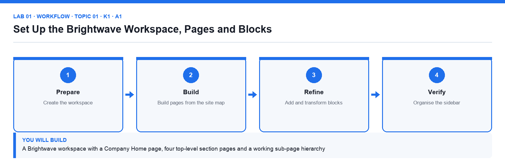

# Lab 01: Set Up the Brightwave Workspace, Pages and Blocks

**Topic 01** · **Day 1** · **Foundation** · **K1 · A1** · **Notion (web or desktop app)**

## Goal

You create the Brightwave Media workspace, build the top-level page structure from the supplied site map, and learn how blocks, slash commands, sub-pages, breadcrumbs and the sidebar work by building the Company Home page.

## What you will build

A Brightwave workspace with a Company Home page, four top-level section pages and a working sub-page hierarchy

*Figure. Lab 01 workflow — the four stages and the artifact produced.*

## Files in this folder

- `brightwave-company-profile.md` — Company background used for the Company Home callout
- `workspace-structure.csv` — Site map of the four sections and their sub-pages
- `LAB-01-Instructions.pdf` — printable detailed guide
- `LAB-01-Workflow.png` — the workflow diagram above
- `lab.yaml` — lab metadata (topic, K/A codes, files, acceptance check)

## Procedure

1. **Sign in and create the workspace**

   Go to notion.com and sign in (a free personal account is enough for the course). In the workspace switcher at the top left choose Create or join workspace, select For my team, name it Brightwave Media and choose the Free plan. The new workspace opens with a Getting Started page.

2. **Read the supplied site map**

   Open workspace-structure.csv from the lab folder. It lists the four top-level sections — Company Wiki, Content Hub, Client Projects and Help Centre — and the sub-pages each must contain.

3. **Create the Company Home page**

   In the sidebar click + New page (or the + next to Private). Title it Company Home, click Add icon and choose a lighthouse emoji, then Add cover and pick a gallery image. Press Enter to start writing in the body.

4. **Add blocks with slash commands**

   On the first empty line type /heading 1 and enter Welcome to Brightwave. Type /callout and write the one-line purpose of the workspace from brightwave-company-profile.md. Type /divider, then /bulleted list and list the four sections.

5. **Transform and rearrange blocks**

   Hover a bullet, click the ⋮⋮ handle and choose Turn into → Toggle list. Drag the callout above the heading using the ⋮⋮ handle, then drag it back. Right-click a block to Duplicate and Delete it.

6. **Create the four section pages as sub-pages**

   Under the bulleted list type /page and title it Company Wiki; press the back breadcrumb to return. Repeat for Content Hub, Client Projects and Help Centre. Each appears nested under Company Home in the sidebar.

7. **Build the second level from the site map**

   Open Company Wiki and create the sub-pages listed in the CSV (About Brightwave, Policies, Team Directory, Onboarding). Do the same for the other three sections. Use the breadcrumbs at the top to move back up.

8. **Organise the sidebar**

   Drag Company Home to the top of the Private section, click the ⋯ next to it and choose Add to Favorites so a Favorites section appears. Collapse and expand the toggles to check the hierarchy matches the CSV.

9. **Record the result**

   Open the Steps checklist in the lab README and tick each step. Take a screenshot of the sidebar showing the full hierarchy for your evidence.

## Acceptance check

The sidebar shows Company Home in Favorites with the four section pages nested under it, each section contains the sub-pages listed in workspace-structure.csv, and Company Home carries an icon, a cover, a heading, a callout and a toggle list.

## Evidence to retain

- Screenshot of the expanded sidebar and of the Company Home page.

## Steps checklist

- [ ] Step 1: Sign in and create the workspace
- [ ] Step 2: Read the supplied site map
- [ ] Step 3: Create the Company Home page
- [ ] Step 4: Add blocks with slash commands
- [ ] Step 5: Transform and rearrange blocks
- [ ] Step 6: Create the four section pages as sub-pages
- [ ] Step 7: Build the second level from the site map
- [ ] Step 8: Organise the sidebar
- [ ] Step 9: Record the result

---

*Mastering Notion for Content, Project, and Database Management · TGS-2023041080 · Version v6 · © 2026 Tertiary Infotech Academy Pte Ltd*