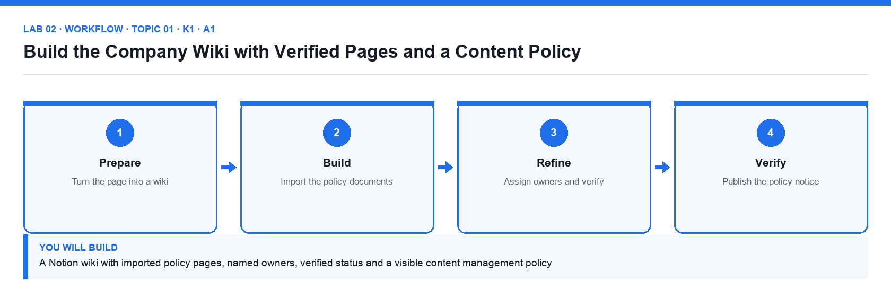

# Lab 02: Build the Company Wiki with Verified Pages and a Content Policy

**Topic 01** · **Day 1** · **Foundation** · **K1 · A1** · **Notion, Markdown import**

## Goal

You turn the Company Wiki into a Notion wiki, import the supplied policy documents, assign page owners, verify the authoritative pages with an expiry date, and publish the content management policy that governs the rest of the workspace.

## What you will build

A Notion wiki with imported policy pages, named owners, verified status and a visible content management policy

*Figure. Lab 02 workflow — the four stages and the artifact produced.*

## Files in this folder

- `policies/content-management-policy.md` — The organisation's content management policy to import
- `policies/naming-conventions.md` — Page naming and structure conventions to import
- `page-owner-register.csv` — Which person owns which wiki page
- `LAB-02-Instructions.pdf` — printable detailed guide
- `LAB-02-Workflow.png` — the workflow diagram above
- `lab.yaml` — lab metadata (topic, K/A codes, files, acceptance check)

## Procedure

1. **Move Company Home into a teamspace**

   Wikis live in teamspaces. In the sidebar click the ⋯ next to Company Home → Move to → your workspace's default teamspace (created with the workspace). The whole hierarchy moves with it.

2. **Turn Company Wiki into a wiki**

   Open Company Wiki, click the ⋯ at the top right and choose Turn into wiki. Notion adds a wiki header with Owner, Verification and Last edited columns and a home view of all pages.

3. **Import the policy documents**

   Open the Policies sub-page. Click Import in the sidebar (or the ⋯ → Import), choose Text & Markdown and upload content-management-policy.md and naming-conventions.md from the policies folder. Move the imported pages under Policies if they land elsewhere.

4. **Read the content management policy**

   Open the imported Content Management Policy page. Note the five rules: one owner per page, verified pages expire after 90 days, naming convention for titles, approved templates only, and permissions by teamspace. Every later lab applies these rules.

5. **Assign page owners**

   Open page-owner-register.csv. In the wiki's All pages view set the Owner property for each page to the named person (assign yourself where the register says 'Content Manager'). The Owner column shows a person avatar.

6. **Verify the authoritative pages**

   Open Content Management Policy, click Verify at the top → Verify this page, and set expiry to 90 days. Repeat for Naming Conventions and About Brightwave. A green verified badge appears; unverified pages show none.

7. **Add the verification view**

   In the wiki home click + Add a view → Table, name it Verification, group by Verification status and add a filter Verification is not Verified so the owner sees what still needs review.

8. **Add the policy notice to Company Home**

   On Company Home add a callout that reads 'All pages follow the Content Management Policy' and use @ to mention the policy page inside the callout so it links directly.

9. **Check compliance against the naming convention**

   Rename any page that breaks the naming convention (Title Case, no abbreviations, no dates in titles). Confirm every page in the wiki has an owner.

## Acceptance check

Company Wiki shows the wiki header, three pages carry the green Verified badge with a 90-day expiry, every page has an owner matching page-owner-register.csv, the Verification view lists only unverified pages, and Company Home links to the policy.

## Evidence to retain

- Screenshot of the wiki home with the Owner and Verification columns, and of a verified page header.

## Steps checklist

- [ ] Step 1: Move Company Home into a teamspace
- [ ] Step 2: Turn Company Wiki into a wiki
- [ ] Step 3: Import the policy documents
- [ ] Step 4: Read the content management policy
- [ ] Step 5: Assign page owners
- [ ] Step 6: Verify the authoritative pages
- [ ] Step 7: Add the verification view
- [ ] Step 8: Add the policy notice to Company Home
- [ ] Step 9: Check compliance against the naming convention

---

*Mastering Notion for Content, Project, and Database Management · TGS-2023041080 · Version v6 · © 2026 Tertiary Infotech Academy Pte Ltd*