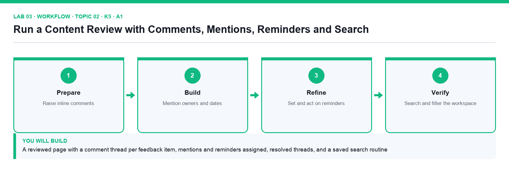

# Lab 03: Run a Content Review with Comments, Mentions, Reminders and Search

**Topic 02** · **Day 1** · **Intermediate** · **K5 · A1** · **Notion comments, mentions, reminders, Inbox, Search**

## Goal

Acting as the reviewer of the About Brightwave page, you raise the feedback items from the supplied review sheet as comments, mention the owners, set dated reminders, resolve threads, watch the Inbox, and use Search filters to find every page that mentions a client.

## What you will build

A reviewed page with a comment thread per feedback item, mentions and reminders assigned, resolved threads, and a saved search routine

*Figure. Lab 03 workflow — the four stages and the artifact produced.*

## Files in this folder

- `review-feedback.csv` — Six review comments to raise, with target text, action and owner
- `reminders.csv` — The two follow-up dates and their owners
- `LAB-03-Instructions.pdf` — printable detailed guide
- `LAB-03-Workflow.png` — the workflow diagram above
- `lab.yaml` — lab metadata (topic, K/A codes, files, acceptance check)

## Procedure

1. **Open the page to review**

   Open Company Wiki → About Brightwave. Open review-feedback.csv: each row is a feedback item with the text to comment on, the action needed and the owner.

2. **Add a top-level page discussion**

   Click Add comment under the page title (the page discussion area). Write 'Review round 1 — see inline comments' and post it with Cmd/Ctrl+Enter.

3. **Raise inline comments**

   For each CSV row, highlight the sentence named in the Target text column, click Comment in the floating toolbar and paste the Action text. Six inline comments should appear in the right-hand comments sidebar.

4. **Mention the owner in each comment**

   Edit each comment and type @ followed by the owner's name (use your own name for items owned by the Content Manager). The mentioned person receives a notification in Inbox and by email.

5. **Add dated reminders**

   In the two comments marked Follow-up in the CSV, type @ then a date such as @tomorrow, click the date and set Remind → On the day at 9:00 AM. The date chip now shows a bell icon.

6. **Resolve and reopen a thread**

   Fix the typo named in row 1 directly in the page text, then click ✓ Resolve on that comment. Open the comments sidebar → Resolved to see it, and click Reopen to see it return.

7. **Read the Inbox**

   Click Inbox in the sidebar. Check that your mentions appear under the Inbox tab and that the page change appears under All. Archive one notification.

8. **Use Search with filters**

   Press Cmd/Ctrl+K or click Search. Type Nova Retail (a client named in the profile). Use the filters to limit to Only match titles off, Created by you, and In: Company Wiki; sort by Last edited. Note how many pages match.

9. **Search inside a page and check page history**

   Open About Brightwave, press Cmd/Ctrl+F to find 'founded', then open ⋯ → Page history to see the snapshot from before your edits.

## Acceptance check

About Brightwave shows one resolved and five open inline comments, each with an @-mentioned owner, two comments carry reminder bells, the Inbox lists the mentions, and the Nova Retail search returns the pages that name that client.

## Evidence to retain

- Screenshot of the comments sidebar with mentions and reminder chips, and of the filtered search results.

## Steps checklist

- [ ] Step 1: Open the page to review
- [ ] Step 2: Add a top-level page discussion
- [ ] Step 3: Raise inline comments
- [ ] Step 4: Mention the owner in each comment
- [ ] Step 5: Add dated reminders
- [ ] Step 6: Resolve and reopen a thread
- [ ] Step 7: Read the Inbox
- [ ] Step 8: Use Search with filters
- [ ] Step 9: Search inside a page and check page history

---

*Mastering Notion for Content, Project, and Database Management · TGS-2023041080 · Version v6 · © 2026 Tertiary Infotech Academy Pte Ltd*