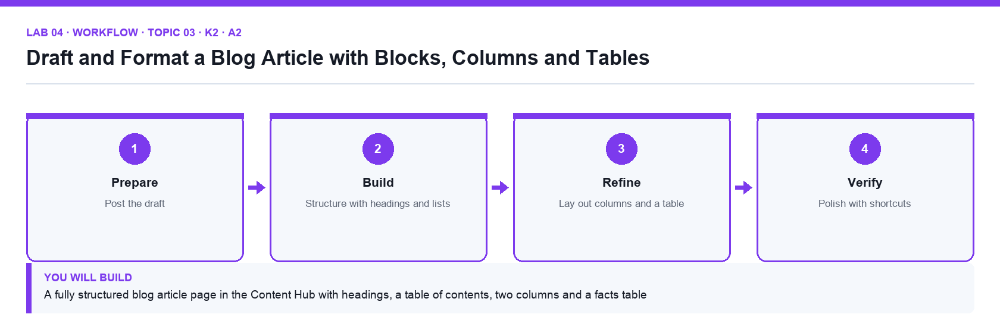

# Lab 04: Draft and Format a Blog Article with Blocks, Columns and Tables

**Topic 03** · **Day 1** · **Foundation** · **K2 · A2** · **Notion editor, Markdown shortcuts**

## Goal

You post the supplied blog article draft into the Content Hub, structure it with headings, lists, toggles, quotes and dividers using slash commands and Markdown shortcuts, lay out a two-column comparison, and add a simple table from the facts sheet so the article is ready for deployment.

## What you will build

A fully structured blog article page in the Content Hub with headings, a table of contents, two columns and a facts table

*Figure. Lab 04 workflow — the four stages and the artifact produced.*

## Files in this folder

- `blog-article-draft.md` — The article text to post, in Markdown
- `article-facts-table.csv` — The figures for the 'By the numbers' table
- `LAB-04-Instructions.pdf` — printable detailed guide
- `LAB-04-Workflow.png` — the workflow diagram above
- `lab.yaml` — lab metadata (topic, K/A codes, files, acceptance check)

## Procedure

1. **Create the article page**

   Open Content Hub → Blog Articles (create the sub-page if it is missing) and add a new page titled Five Content Trends for 2027. Add an icon and cover so it is recognisable in the sidebar.

2. **Paste the draft as blocks**

   Open blog-article-draft.md, copy everything and paste into the page. Notion converts each Markdown heading, bullet and paragraph into its own block. Check the headings arrived as Heading 1/2 blocks (hover shows the type).

3. **Add a table of contents**

   Directly under the title type /table of contents. The block lists every heading and updates as you edit. Click an entry to jump.

4. **Apply Markdown and keyboard shortcuts**

   In the introduction: type ** around a phrase for bold, use Cmd/Ctrl+E for inline code on the tool names, Cmd/Ctrl+Shift+H to highlight, and Cmd/Ctrl+Shift+7 to turn the trend list into a numbered list. Undo with Cmd/Ctrl+Z.

5. **Use toggles and quotes**

   Turn the 'Methodology' paragraph into a toggle (type > at the start of the line) so it is collapsed by default. Turn the expert quotation into a quote block with the ⋮⋮ → Turn into menu.

6. **Create a two-column layout**

   Drag the 'Short-form video' paragraph to the right edge of the 'Long-form articles' paragraph until a blue vertical guide appears and drop it. Drag the column divider to make the columns equal. Use the ⋮⋮ → Turn into → Text of the column to remove it if needed.

7. **Insert a simple table**

   Under 'By the numbers' type /table and choose Table (the simple table, not a database). Give it 3 columns and 6 rows, tick Header row, and type the values from article-facts-table.csv. Use the ⋮⋮ on a row to reorder.

8. **Add dividers and headings**

   Insert /divider between major sections and check the heading hierarchy: one Heading 1, Heading 2 per trend, Heading 3 for sub-points. Fix any level that breaks the hierarchy.

9. **Duplicate, delete and restore**

   Duplicate the table with ⋮⋮ → Duplicate, delete the copy with Delete, then open Trash in the sidebar to see deleted pages, and ⋯ → Page history to confirm a snapshot exists.

## Acceptance check

The article page has a working table of contents, one Heading 1 and a Heading 2 per trend, a collapsed toggle, a quote block, an equal two-column section and a six-row simple table with a header row matching article-facts-table.csv.

## Evidence to retain

- Screenshot of the article showing the table of contents, columns and table.

## Steps checklist

- [ ] Step 1: Create the article page
- [ ] Step 2: Paste the draft as blocks
- [ ] Step 3: Add a table of contents
- [ ] Step 4: Apply Markdown and keyboard shortcuts
- [ ] Step 5: Use toggles and quotes
- [ ] Step 6: Create a two-column layout
- [ ] Step 7: Insert a simple table
- [ ] Step 8: Add dividers and headings
- [ ] Step 9: Duplicate, delete and restore

---

*Mastering Notion for Content, Project, and Database Management · TGS-2023041080 · Version v6 · © 2026 Tertiary Infotech Academy Pte Ltd*