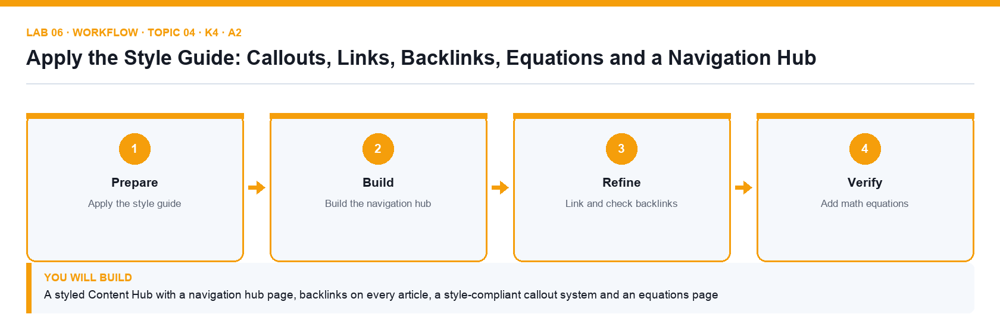

# Lab 06: Apply the Style Guide: Callouts, Links, Backlinks, Equations and a Navigation Hub

**Topic 04** · **Day 1** · **Intermediate** · **K4 · A2** · **Notion styling, links and backlinks, math equations, link-to-page blocks**

## Goal

You apply the supplied Brightwave style guide across the Content Hub — colours, fonts, callout conventions, icons and covers — build a navigation hub with link-to-page blocks and backlinks so every article is reachable in two clicks, and document the pricing formula with KaTeX equations.

## What you will build

A styled Content Hub with a navigation hub page, backlinks on every article, a style-compliant callout system and an equations page

*Figure. Lab 06 workflow — the four stages and the artifact produced.*

## Files in this folder

- `style-guide.md` — Brightwave content style guide
- `navigation-map.csv` — Which pages the hub must link to, in order
- `equations.md` — The retainer and ROI formulas in KaTeX
- `LAB-06-Instructions.pdf` — printable detailed guide
- `LAB-06-Workflow.png` — the workflow diagram above
- `lab.yaml` — lab metadata (topic, K/A codes, files, acceptance check)

## Procedure

1. **Read the style guide**

   Open style-guide.md. Note the rules: blue callouts for tips, yellow for warnings, red for policy; serif font is not allowed; page icons must be emoji; covers only on section pages; small text off.

2. **Fix page-level styling**

   Open Five Content Trends for 2027 → ⋯ menu. Set Font to Default, turn Small text off and Full width on. Check the icon is an emoji and remove the cover (the article is not a section page).

3. **Apply text and background colours**

   Select the key statistic in the introduction and use the toolbar A menu to set a blue text colour. Select the warning sentence and set a yellow background. Use Cmd/Ctrl+Shift+H to repeat the last colour.

4. **Standardise callouts**

   Convert the tip paragraph into a callout with a 💡 icon and blue background, the caution paragraph into a callout with ⚠️ and yellow background, and add a red policy callout that @-mentions the Content Management Policy.

5. **Build the navigation hub**

   Open Content Hub. Type /link to page for each article and for Blog Articles, Newsletters and Social Posts (create empty pages where needed). Add a heading 'Start here', a table of contents block and a divider between groups.

6. **Create inline links two ways**

   In the article introduction type @ and choose the Content Hub page to create an inline mention; then type [[ and choose Company Home. Highlight the word 'policy', press Cmd/Ctrl+K and paste the policy page URL to link plain text.

7. **Check backlinks**

   Open Company Home. Under the title, click the Backlinks indicator to see every page that links here, including the article. In ⋯ → Customize page set Backlinks to Show in popover and Comments to Expanded.

8. **Add math equations**

   Create a page Pricing Formulas under Company Wiki → Policies. Type /math equation and enter the block equation from equations.md (the retainer formula). In a sentence type $$ROI = \frac{Gain - Cost}{Cost}$$ to render it inline, then click it to edit.

9. **Add icons and covers to section pages**

   Give the four section pages a distinct emoji icon and a cover each (Unsplash search in the cover picker). Confirm no article page has a cover, per the style guide.

## Acceptance check

Every article follows the style guide (default font, emoji icon, no cover, colour-coded callouts), Content Hub is a navigation hub with link-to-page blocks and a table of contents, Company Home's backlinks list the article, and Pricing Formulas renders a block and an inline KaTeX equation.

## Evidence to retain

- Screenshot of the navigation hub, of the backlinks popover and of the equations page.

## Steps checklist

- [ ] Step 1: Read the style guide
- [ ] Step 2: Fix page-level styling
- [ ] Step 3: Apply text and background colours
- [ ] Step 4: Standardise callouts
- [ ] Step 5: Build the navigation hub
- [ ] Step 6: Create inline links two ways
- [ ] Step 7: Check backlinks
- [ ] Step 8: Add math equations
- [ ] Step 9: Add icons and covers to section pages

---

*Mastering Notion for Content, Project, and Database Management · TGS-2023041080 · Version v6 · © 2026 Tertiary Infotech Academy Pte Ltd*