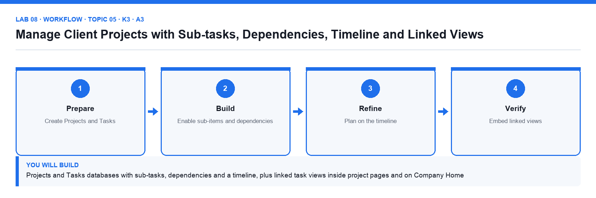

# Lab 08: Manage Client Projects with Sub-tasks, Dependencies, Timeline and Linked Views

**Topic 05** · **Day 2** · **Intermediate** · **K3 · A3** · **Notion databases (timeline, sub-items, dependencies, linked views)**

## Goal

You create the Projects and Tasks databases in Client Projects from the supplied CSVs, turn on sub-items and dependencies so date changes shift dependent tasks, plan the Nova Retail launch on a timeline, and embed linked views of the tasks inside each project page and on the Company Home dashboard.

## What you will build

Projects and Tasks databases with sub-tasks, dependencies and a timeline, plus linked task views inside project pages and on Company Home

*Figure. Lab 08 workflow — the four stages and the artifact produced.*

## Files in this folder

- `projects.csv` — Six client projects with client, dates, stage and budget
- `tasks.csv` — Twenty-four tasks with parents, dependencies, assignees and estimates
- `LAB-08-Instructions.pdf` — printable detailed guide
- `LAB-08-Workflow.png` — the workflow diagram above
- `lab.yaml` — lab metadata (topic, K/A codes, files, acceptance check)

## Procedure

1. **Create the Tasks database**

   Open Client Projects. Import tasks.csv as a database named Tasks. Set Status → Status, Due → Date (with end date), Assignee → Person, Estimate (h) → Number, Priority → Select.

2. **Create the Projects database**

   Import projects.csv as Projects. Set Client → Select, Dates → Date range, Stage → Status, Budget (SGD) → Number with SGD format.

3. **Turn on sub-items**

   In Tasks click ⋯ → Sub-items → Turn on. Notion adds Parent item and Sub-items properties. Using tasks.csv's Parent column, open each parent task and add its sub-tasks; the table shows a toggle arrow on parents.

4. **Turn on dependencies**

   Click ⋯ → Dependencies → Turn on, choose Shift only when dates overlap, and set the Blocked by / Blocking properties. Using the Depends on column in the CSV, add each dependency.

5. **Add a timeline view**

   Add a Timeline view of Tasks, choose Timeline by Due, Month zoom, and Show table with Name, Assignee and Status. Dependency arrows appear between bars.

6. **Shift a date and watch dependencies move**

   Drag the 'Approve creative concept' bar two days later. The dependent 'Produce launch assets' task shifts too. Undo with Cmd/Ctrl+Z and note the behaviour in your README checklist.

7. **Group and filter the timeline**

   Group the timeline by Assignee, then filter Status is not Done. Add a table view named Overdue with filter Due is before Today AND Status is not Done.

8. **Embed a linked view inside a project page**

   Open the Nova Retail Launch project page. Type /linked view of database, choose Tasks, and Create new empty view. Filter it to Project contains Nova Retail Launch (create a Project relation property in Tasks first if it does not exist — Lab 9 completes this). Hide the database title.

9. **Add a dashboard linked view to Company Home**

   On Company Home add /linked view of database → Tasks → copy the Overdue view. Now the home page shows overdue work across all clients. Add a linked calendar of Content Calendar beside it in a second column.

10. **Lock views on the linked database**

   On the Company Home linked views use ⋯ → Lock views so the dashboard layout stays fixed while data still changes.

## Acceptance check

Tasks has parent tasks with sub-items and dependency arrows on the timeline, moving a blocking task shifts its dependents, the Overdue view lists only late open tasks, the Nova Retail Launch page shows only its own tasks in a linked view, and Company Home shows locked linked views of Tasks and Content Calendar.

## Evidence to retain

- Screenshot of the timeline with dependencies and of the Company Home dashboard.

## Steps checklist

- [ ] Step 1: Create the Tasks database
- [ ] Step 2: Create the Projects database
- [ ] Step 3: Turn on sub-items
- [ ] Step 4: Turn on dependencies
- [ ] Step 5: Add a timeline view
- [ ] Step 6: Shift a date and watch dependencies move
- [ ] Step 7: Group and filter the timeline
- [ ] Step 8: Embed a linked view inside a project page
- [ ] Step 9: Add a dashboard linked view to Company Home
- [ ] Step 10: Lock views on the linked database

---

*Mastering Notion for Content, Project, and Database Management · TGS-2023041080 · Version v6 · © 2026 Tertiary Infotech Academy Pte Ltd*