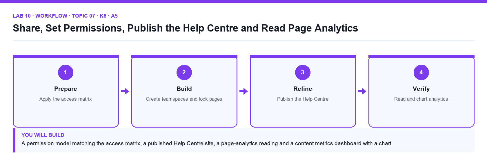

# Lab 10: Share, Set Permissions, Publish the Help Centre and Read Page Analytics

**Topic 07** · **Day 2** · **Intermediate** · **K6 · A5** · **Notion sharing, teamspaces, Publish to web, page analytics, chart view**

## Goal

You apply the supplied access matrix with members, guests, groups and teamspaces, lock the policy pages, publish the Help Centre to the web with search indexing and a public home page, then read page analytics and build a metrics dashboard from the supplied analytics sample so you can report on views, visitors and engagement.

## What you will build

A permission model matching the access matrix, a published Help Centre site, a page-analytics reading and a content metrics dashboard with a chart

*Figure. Lab 10 workflow — the four stages and the artifact produced.*

## Files in this folder

- `access-matrix.csv` — Roles versus sections with the required permission level
- `page-analytics-sample.csv` — Twelve weeks of views, visitors and time-on-page by page
- `publish-checklist.md` — Pre-publication checklist for public pages
- `LAB-10-Instructions.pdf` — printable detailed guide
- `LAB-10-Workflow.png` — the workflow diagram above
- `lab.yaml` — lab metadata (topic, K/A codes, files, acceptance check)

## Procedure

1. **Read the access matrix**

   Open access-matrix.csv. It lists each role (Editor, Designer, Account Manager, Client guest) against each section and the permission level required (Full access, Can edit, Can edit content, Can comment, Can view).

2. **Invite a member and a guest**

   Open Settings → People. Add a member with a second email you control (or a classmate). Then open Client Projects → Nova Retail Launch, click Share, enter a client email and set Can comment — the person appears as a Guest in Settings → People → Guests.

3. **Create a group**

   In Settings → People → Groups create Editors and add the member. Share Content Hub with the Editors group at Can edit. Groups keep permissions repeatable as people join or leave.

4. **Create a closed teamspace for clients**

   In the sidebar click + next to Teamspaces, name it Client Work, set it to Closed, and move Client Projects into it. Set the default access to Can edit content on the databases so guests can add rows but not change structure.

5. **Apply 'can edit content' and page lock**

   Open Content Calendar → Share and set the Editors group to Can edit content. Open Content Management Policy, click ⋯ → Lock page; try to type and observe the lock. Open Tasks → ⋯ → Lock database.

6. **Review security settings**

   In Settings → Security review Disable guests, Disable public page sharing, Disable export and Allowed email domains. Leave public sharing on (needed next) and note which settings Brightwave's policy would turn on.

7. **Publish the Help Centre**

   Open Help Centre → Share → Publish → Publish to web. Turn on Search engine indexing, turn off Allow duplicate as template, keep Allow comments off, and copy the notion.site link. Open it in a private window.

8. **Set a public home page and check the visitor view**

   In Settings → Sites (or Public pages) set Help Centre as the home page for the site. In the private window check navigation, breadcrumbs and that private pages are not reachable.

9. **Read page analytics**

   Open Help Centre → ⋯ → Analytics (or the clock icon). Note Views, Unique visitors and the viewer list for the last 7 and 30 days. Open Settings → Analytics for workspace-level content, member and search analytics on paid plans.

10. **Build the metrics dashboard**

   Import page-analytics-sample.csv as a database Content Metrics under Company Wiki. Add a Chart view: vertical bar, X axis = Week, Y axis = Sum of Views, grouped by Section. Add a second chart view: donut of Sum of Unique Visitors by Channel. Add a formula Engagement = round(prop("Avg Time (s)") / 60) and a callout that states the top three pages this month.

## Acceptance check

Sharing matches access-matrix.csv (member, guest, Editors group, closed Client Work teamspace), the policy page is locked, the Help Centre opens at a public notion.site URL with indexing on and duplication off, page analytics show views and unique visitors, and Content Metrics has two chart views and an Engagement formula.

## Evidence to retain

- Screenshots of the Share dialog, the public site in a private window, the page analytics panel and the metrics chart.

## Steps checklist

- [ ] Step 1: Read the access matrix
- [ ] Step 2: Invite a member and a guest
- [ ] Step 3: Create a group
- [ ] Step 4: Create a closed teamspace for clients
- [ ] Step 5: Apply 'can edit content' and page lock
- [ ] Step 6: Review security settings
- [ ] Step 7: Publish the Help Centre
- [ ] Step 8: Set a public home page and check the visitor view
- [ ] Step 9: Read page analytics
- [ ] Step 10: Build the metrics dashboard

---

*Mastering Notion for Content, Project, and Database Management · TGS-2023041080 · Version v6 · © 2026 Tertiary Infotech Academy Pte Ltd*