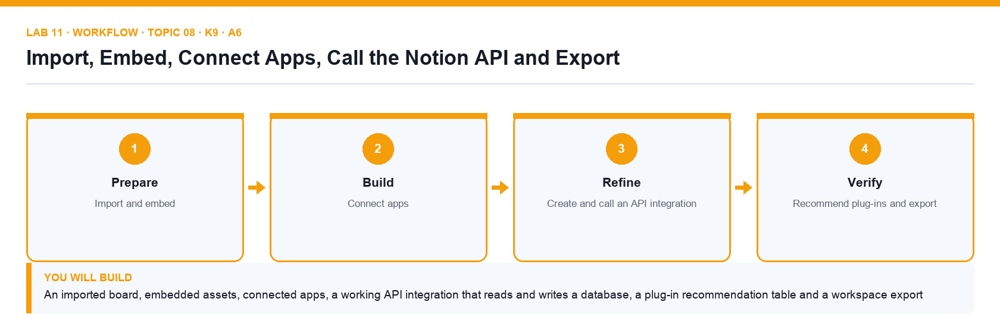

# Lab 11: Import, Embed, Connect Apps, Call the Notion API and Export

**Topic 08** · **Day 2** · **Advanced** · **K9 · A6** · **Notion Import, embeds, Connections, Notion API (integration token), Export**

## Goal

You import a Trello-style board export, embed Google Drive, Figma and Loom links, connect Slack and GitHub, create an internal integration and use its token to query the Content Calendar and create a page through the Notion API, evaluate the supplied integration catalogue to recommend plug-ins for Brightwave, and export the workspace as Markdown + CSV.

## What you will build

An imported board, embedded assets, connected apps, a working API integration that reads and writes a database, a plug-in recommendation table and a workspace export

*Figure. Lab 11 workflow — the four stages and the artifact produced.*

## Files in this folder

- `trello-board-export.csv` — A Trello-style board export to import
- `embed-links.md` — Drive, Figma, Loom and Maps links to embed
- `notion-api/notion_api.py` — Python client for query and create calls
- `notion-api/query-database.sh` — curl version of the data source query
- `notion-api/query-database.json` — Filter body for the query
- `notion-api/create-page.json` — Properties body for the create-page call
- `notion-api/.env.example` — Where the integration secret and database ID go
- `api-data-model.md` — The database and data source objects explained
- `integration-catalogue.csv` — Twelve integrations to evaluate
- `export-checklist.md` — Export and backup checklist
- `LAB-11-Instructions.pdf` — printable detailed guide
- `LAB-11-Workflow.png` — the workflow diagram above
- `lab.yaml` — lab metadata (topic, K/A codes, files, acceptance check)

## Procedure

1. **Import the Trello-style board**

   In the sidebar click Import → CSV and choose trello-board-export.csv (List, Card, Labels, Due, Members). Notion builds a database; add a Board view grouped by List to recreate the kanban.

2. **Embed external assets**

   On Nova Retail Launch type /embed and paste the Google Drive, Figma and Loom links from embed-links.md; resize each embed. Paste a Google Maps URL as a link and choose Create embed.

3. **Connect Slack and GitHub**

   Open Settings → My connections (or Connections) and connect Slack; then in Deliverables automation add an action Send Slack notification to a channel. Connect GitHub and paste a pull-request URL into a page to see it unfurl as a link preview.

4. **Create an internal integration**

   Go to https://www.notion.so/profile/integrations → New integration. Name it Brightwave Bot, choose the Brightwave workspace, type Internal, capabilities Read, Update, Insert content. Copy the Internal Integration Secret into notion-api/.env (never into a page).

5. **Share a database with the integration**

   Open Content Calendar → ⋯ → Connections → Connect to → Brightwave Bot. Copy the database ID from the page URL (the 32-character string before ?v=) into notion-api/.env as DATABASE_ID.

6. **Query the data source with the API**

   In a terminal run bash notion-api/query-database.sh (or python3 notion-api/notion_api.py query). The script sends POST https://api.notion.com/v1/data_sources/{id}/query with the Notion-Version header and prints each row's Name and Status. Read query-database.json to see the filter body.

7. **Create a page through the API**

   Run python3 notion-api/notion_api.py create. It posts create-page.json to /v1/pages with the parent data source and properties Name, Status = Draft and Channel = Blog. Refresh Content Calendar — the new row appears.

8. **Review the API data model**

   Open api-data-model.md: a database object contains one or more data sources; each data source has a properties schema and pages as rows (API version 2025-09-03). Note the object, id, data_sources, title, is_inline and public_url fields.

9. **Recommend plug-ins**

   Open integration-catalogue.csv (Zapier, Make, Slack, Google Drive, Figma, Typeform, Whimsical, Loom, GitHub, Notion Web Clipper, Super.so, Notion Calendar). Score each for Brightwave on the criteria given and write your top-three recommendation with one sentence of justification each in a page Recommended Integrations.

10. **Export for data integrity**

   Export Five Content Trends for 2027 as PDF (⋯ → Export). Then Settings → Settings → Export all workspace content as Markdown & CSV, include subpages, and check the ZIP contains the CSVs of every database. Record the export date in export-checklist.md.

## Acceptance check

The Trello import shows as a board, the project page embeds three external assets, Slack and GitHub are connected, the API query prints the calendar rows and the API create call adds a Draft row, Recommended Integrations names three tools with justification, and a Markdown & CSV workspace export has been downloaded.

## Evidence to retain

- Terminal output of the query and create scripts (token redacted), screenshot of the Connections list and of the export dialog.

## Steps checklist

- [ ] Step 1: Import the Trello-style board
- [ ] Step 2: Embed external assets
- [ ] Step 3: Connect Slack and GitHub
- [ ] Step 4: Create an internal integration
- [ ] Step 5: Share a database with the integration
- [ ] Step 6: Query the data source with the API
- [ ] Step 7: Create a page through the API
- [ ] Step 8: Review the API data model
- [ ] Step 9: Recommend plug-ins
- [ ] Step 10: Export for data integrity

---

*Mastering Notion for Content, Project, and Database Management · TGS-2023041080 · Version v6 · © 2026 Tertiary Infotech Academy Pte Ltd*