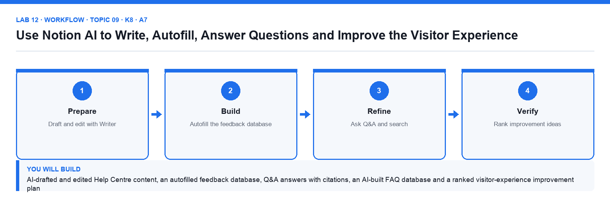

# Lab 12: Use Notion AI to Write, Autofill, Answer Questions and Improve the Visitor Experience

**Topic 09** · **Day 2** · **Advanced** · **K8 · A7** · **Notion AI (Writer, AI blocks, Autofill, Q&A / Enterprise Search, Build with AI)**

## Goal

You use Notion AI to draft and edit Help Centre articles, add an AI block summary, autofill keywords and sentiment on the supplied visitor feedback database, ask Q&A questions across the workspace, build a FAQ database with AI, and turn the answers into a prioritised list of visitor-experience improvements for the public Help Centre.

## What you will build

AI-drafted and edited Help Centre content, an autofilled feedback database, Q&A answers with citations, an AI-built FAQ database and a ranked visitor-experience improvement plan

*Figure. Lab 12 workflow — the four stages and the artifact produced.*

## Files in this folder

- `ai-prompts.md` — The prompts used in this lab
- `visitor-feedback.csv` — Forty visitor feedback entries about the Help Centre
- `faq-seed.csv` — Twelve FAQ questions and draft answers
- `improvement-ideas-template.md` — Structure for the Visitor Experience Plan
- `LAB-12-Instructions.pdf` — printable detailed guide
- `LAB-12-Workflow.png` — the workflow diagram above
- `lab.yaml` — lab metadata (topic, K/A codes, files, acceptance check)

## Procedure

1. **Check your AI access**

   Notion AI is included in Business and Enterprise plans; Free and Plus workspaces get complimentary trial responses, and the trainer can share the course Business workspace if the trial is exhausted. Open Settings → Notion AI and read the AI Web Search and data-sharing settings.

2. **Draft with Writer**

   Open Help Centre → create page How to Request a Content Change. Press Space on the empty line and paste prompt 1 from ai-prompts.md. Review the draft, click Try again or Make longer, then Insert below.

3. **Edit existing text**

   Highlight the imported About Brightwave introduction, click Ask AI, and run Fix spelling & grammar, then Make shorter, then Change tone → Professional. Accept one change and discard another.

4. **Add an AI block**

   At the top of Five Content Trends for 2027 type /AI block → Summary. Click Generate; edit the article and click Generate again to refresh. Add a second AI block with the custom prompt from ai-prompts.md (key takeaways for social posts).

5. **Translate a page**

   On How to Request a Content Change open ⋯ → Translate → Simplified Chinese (or another language) and compare the output with the English page.

6. **Autofill the visitor feedback database**

   Import visitor-feedback.csv as Visitor Feedback under Help Centre. Add an AI Autofill property Sentiment (Select: Positive, Neutral, Negative, auto-update on) and another AI Summary property Key issue. Click Update all and review the results for three rows.

7. **Ask Q&A across the workspace**

   Open Notion AI from the sidebar (or Cmd/Ctrl+Shift+J) and ask: 'What does the Content Management Policy say about verification expiry?' Check the citation links to the policy page. Then ask 'Which projects are at risk?' with All sources set to the Client Projects teamspace.

8. **Build a FAQ database with AI**

   Under Help Centre create a new page, choose Database → Build with AI and describe: 'A public FAQ database with Question, Answer, Category, Audience and Last reviewed, with a board view by Category.' Review the suggested properties, click Done and add three FAQs from the feedback.

9. **Generate improvement ideas**

   Ask Notion AI, with the Visitor Feedback database as source, to 'List the ten most common visitor problems and propose one Help Centre improvement for each.' Paste the answer into improvement-ideas-template.md's structure on a page Visitor Experience Plan.

10. **Prioritise and present**

   Turn the ideas into an inline database with Impact (1–5), Effort (1–5) and a formula Priority = prop("Impact") - prop("Effort"). Sort by Priority descending, and write a three-sentence recommendation to the Brightwave management team at the top.

## Acceptance check

How to Request a Content Change was drafted with Writer and translated, the article carries two AI blocks, Visitor Feedback shows autofilled Sentiment and Key issue for every row, Q&A returns cited answers, the FAQ database was built with AI, and Visitor Experience Plan ranks ten improvements by the Priority formula with a management recommendation.

## Evidence to retain

- Screenshots of the autofilled database, a Q&A answer with citation and the ranked improvement plan.

## Steps checklist

- [ ] Step 1: Check your AI access
- [ ] Step 2: Draft with Writer
- [ ] Step 3: Edit existing text
- [ ] Step 4: Add an AI block
- [ ] Step 5: Translate a page
- [ ] Step 6: Autofill the visitor feedback database
- [ ] Step 7: Ask Q&A across the workspace
- [ ] Step 8: Build a FAQ database with AI
- [ ] Step 9: Generate improvement ideas
- [ ] Step 10: Prioritise and present

---

*Mastering Notion for Content, Project, and Database Management · TGS-2023041080 · Version v6 · © 2026 Tertiary Infotech Academy Pte Ltd*